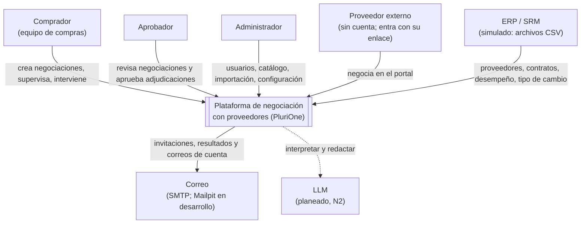
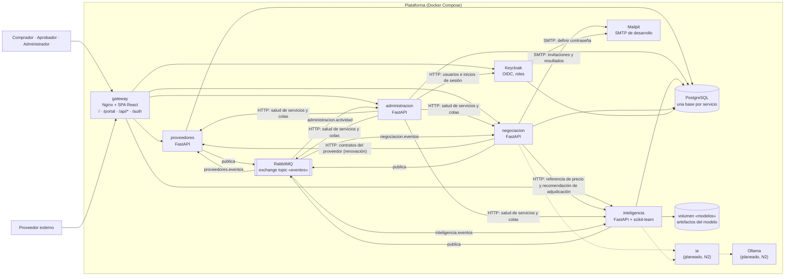
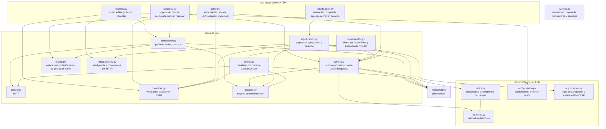
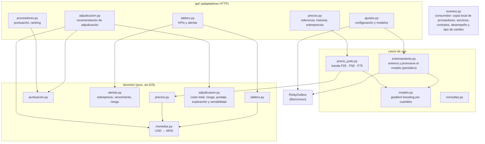

# Diagramas C4

Tres niveles del modelo C4 (contexto, contenedores y componentes), dibujados con Mermaid. Reflejan
el sistema construido al 19/10/2026. Lo que todavía no existe aparece con línea punteada y la
etiqueta «planeado».

## 1. Contexto

Quién usa la plataforma y con qué sistemas externos habla.

## 2. Contenedores

Cada servicio es una aplicación FastAPI con su propia base de datos. Ninguno lee la base de otro:
comparten datos por eventos (RabbitMQ) y, solo cuando necesitan la respuesta en el momento, por
HTTP.

| Contenedor | Tecnología | Responsabilidad | Datos |
|---|---|---|---|
| gateway | Nginx 1.29 con la SPA (React 19, TypeScript, Vite) | Único punto de entrada: sirve la SPA y el portal, enruta `/api/<servicio>` y `/auth`, aplica CSP y cabeceras de seguridad | — |
| Keycloak | Keycloak 26 | Usuarios internos, roles (`comprador`, `aprobador`, `admin`), inicio de sesión OIDC y JWT RS256 | `keycloak_db` |
| proveedores | FastAPI | Proveedores, catálogo de servicios, contratos (importados o nacidos de una adjudicación aprobada), desempeño y tipo de cambio; importación por CSV | `proveedores_db` |
| administracion | FastAPI | Usuarios (con la API de Keycloak), Actividad (bitácora de solo inserción), Correos, Estado del sistema y Panel | `administracion_db` |
| inteligencia | FastAPI, scikit-learn | Precio justo P25 · P50 · P75 (línea base y modelo por cuantiles), puntuación de proveedores, alertas, Tablero y recomendación de adjudicación (costo total, desempeño, riesgo y SLA, con su explicación), sobre una copia local alimentada por eventos | `inteligencia_db` y el volumen `modelos` |
| negociacion | FastAPI | Eventos de negociación, sesiones por proveedor, motor de concesiones, portal del proveedor, invitaciones, adjudicación con aprobación, avisos del resultado y bitácora | `negociacion_db` |
| RabbitMQ | RabbitMQ 4.1 | Exchange `eventos` (topic), cuatro colas *quorum* y sus colas de fallidos | — |
| PostgreSQL | PostgreSQL 17 | Una instancia con una base por servicio. `administracion`, `inteligencia` y `negociacion` usan dos usuarios: el de la aplicación, con permisos mínimos, y el dueño, que migra. `proveedores` y Keycloak usan uno | — |
| Mailpit | Mailpit 1.27 | Buzón SMTP de desarrollo; en producción se cambia por un SMTP real | — |
| ia y Ollama | (planeado, N2) | Único acceso al LLM: interpretar la nota del proveedor y redactar mensajes; nunca decide montos (ADR-002) | — |

## 3. Componentes

### 3.1 negociacion

### 3.2 inteligencia

### 3.3 Piezas comunes (`libs/comun`)

Infraestructura que comparten los servicios, sin modelos de dominio: validación de JWT contra el
JWKS de Keycloak (`auth.py`), errores RFC 9457 en español (`errores.py`, `mensajes.py`), logs JSON
con `X-Request-ID` (`logs.py`), salud (`salud.py`), outbox transaccional y su relay (`outbox.py`),
consumidor idempotente con cola de fallidos (`consumidor.py`) y la topología de RabbitMQ
(`topologia.py`).
