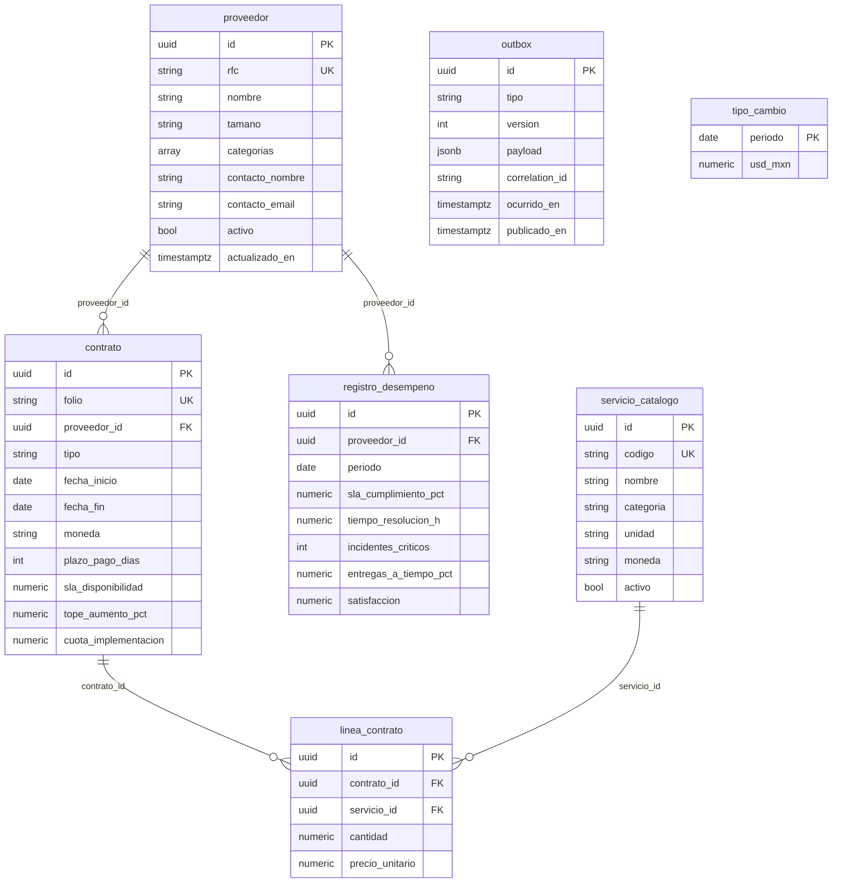
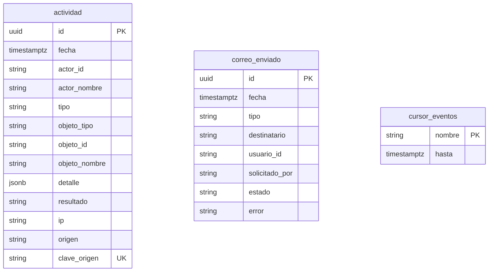
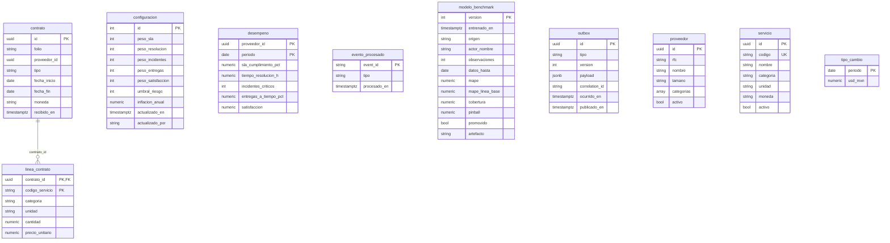
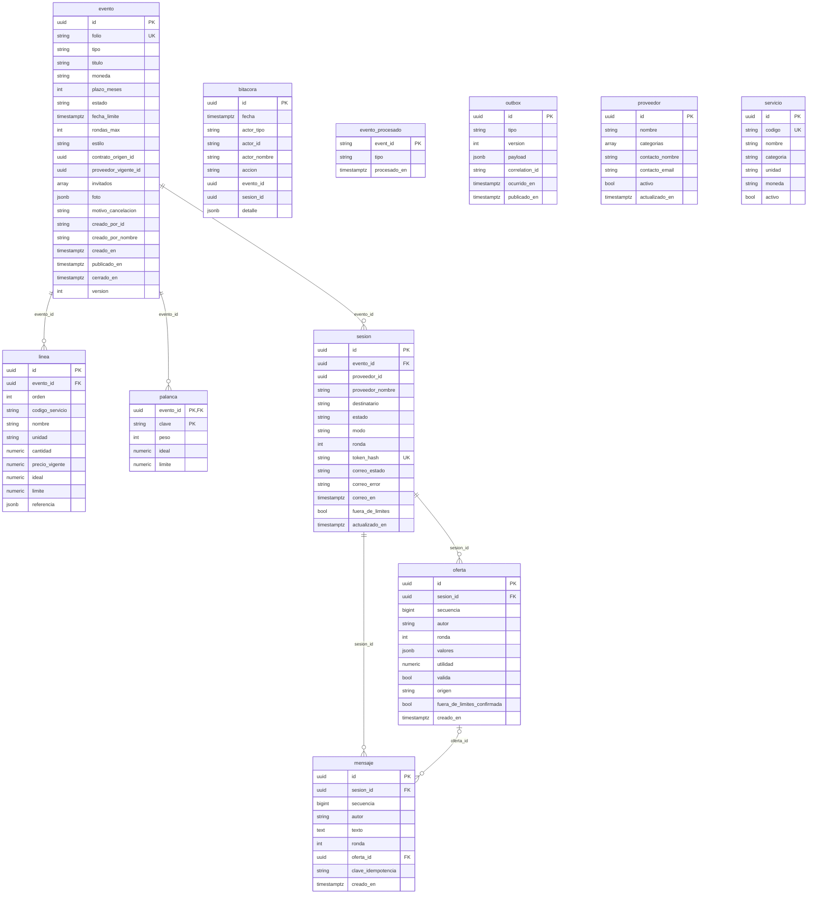

# Modelo de datos

Un diagrama entidad-relación por servicio, generado de los modelos de SQLAlchemy al 15/10/2026
(las migraciones de Alembic de cada servicio crean exactamente estas tablas). Ningún servicio lee
la base de otro: los datos compartidos viajan por eventos y cada quien guarda su copia.

Convenciones de los diagramas: `PK` llave primaria, `FK` llave foránea, `UK` valor único; los
montos son `numeric` (nunca punto flotante) y las fechas con hora, `timestamptz`. Todas las
tablas `outbox` tienen la misma forma: guardan el evento en la misma transacción que el cambio, y
un proceso del servicio lo publica en RabbitMQ.

## proveedores (`proveedores_db`)

La fuente de verdad de los datos maestros: proveedores, catálogo de servicios, contratos con sus líneas, desempeño mensual y tipo de cambio. Todo llega por la importación de CSV (el adaptador del ERP simulado) o por la edición del catálogo, y cada cambio se publica como evento con el `outbox`.

Únicas compuestas: `registro_desempeno` (proveedor_id, periodo).

## administracion (`administracion_db`)

La Actividad (`actividad`) es una bitácora de solo inserción: el usuario de la aplicación no puede actualizar ni borrar filas, y `clave_origen` evita duplicar un evento que llega dos veces. `correo_enviado` alimenta la página Correos y `cursor_eventos` recuerda hasta dónde se leyeron los inicios de sesión de Keycloak.

## inteligencia (`inteligencia_db`)

Una copia local de lo que publica `proveedores` (sin llaves foráneas hacia otros servicios), más la configuración de la puntuación (`configuracion`, una sola fila) y el registro de modelos de precios (`modelo_benchmark`; los artefactos van en el volumen `modelos`). `evento_procesado` hace idempotente al consumidor.

## negociacion (`negociacion_db`)

Un `evento` de negociación (compra o renovación) tiene sus líneas, sus palancas y una `sesion` por proveedor invitado. Cada sesión guarda sus ofertas (con su utilidad y si respetan los límites) y su conversación (`mensaje`). `bitacora` es de solo inserción, como los mensajes y las ofertas. `evento.foto` guarda la fecha de la consulta de precios y, en una renovación, los términos vigentes del contrato de origen; la banda P25 · P50 · P75 de cada línea queda en `linea.referencia`. `proveedor` y `servicio` son copias locales alimentadas por eventos. Del enlace de invitación solo se guarda el hash (`token_hash`).

Únicas compuestas: `linea` (evento_id, orden); `sesion` (evento_id, proveedor_id); `mensaje` (sesion_id, clave_idempotencia).
