# Manual de usuario de PluriOne

Parte del entregable 7. Versión del 28/10/2026: los pasos de los cuatro roles, con capturas de
pantalla, y las preguntas frecuentes. Las capturas son de la versión `mvp-1.2` con datos de prueba,
y se vuelven a tomar con un comando (ver el final). La misma
información, más breve, está dentro de la aplicación, en el Centro de ayuda (botón «?» de la
barra superior).

PluriOne ayuda a una empresa a negociar con sus proveedores de servicios de TI: muestra cuánto se
paga normalmente por cada servicio, deja que un agente negocie por usted dentro de los límites que
usted fija y pide que otra persona apruebe las adjudicaciones grandes.

| Rol | Qué hace |
|---|---|
| Comprador | Consulta proveedores y precios, crea y publica negociaciones, las supervisa y adjudica |
| Aprobador | Aprueba o rechaza las adjudicaciones que superan el umbral o que salen de los límites |
| Proveedor | Negocia en el portal con el enlace de su invitación, sin cuenta |
| Administrador | Usuarios, catálogo, importación de datos, configuración y estado del sistema |

## 1. Cómo entrar

- **Personal de la empresa.** Entre con su usuario o correo y su contraseña. La primera vez, use
  el enlace del correo de invitación para definir su contraseña, o la contraseña temporal que le
  entregó administración: la plataforma le pedirá cambiarla.
- **Si la sesión se cierra sola.** Es por seguridad. Vuelva a iniciar sesión y regresará a la
  página donde estaba.
- **El menú.** A la izquierda, agrupado por áreas: Resumen, Proveedores, Inteligencia,
  Negociación, Sistema (solo administración) y Soporte. El botón de la esquina superior
  izquierda lo contrae a iconos; en pantallas pequeñas, ese mismo botón lo abre.
- **Su cuenta y el tema.** Su nombre y su rol están abajo a la izquierda; desde ahí cierra
  sesión. El tema claro, el oscuro o el del sistema se elige en la barra superior.
- **Proveedores.** No tienen cuenta: entran con el enlace personal de su invitación (sección 3).

## 2. Comprador

### 2.1 Revisar el Tablero

El Tablero es la primera pantalla. Muestra el gasto, los contratos por vencer, los proveedores en
riesgo y el ahorro potencial. La fila «Negociaciones» dice cuántas hay en cada estado y cuántas
sesiones escaladas esperan a una persona; cada número abre la lista filtrada. También muestra el
ahorro logrado: lo adjudicado frente a la primera oferta de cada proveedor ganador.

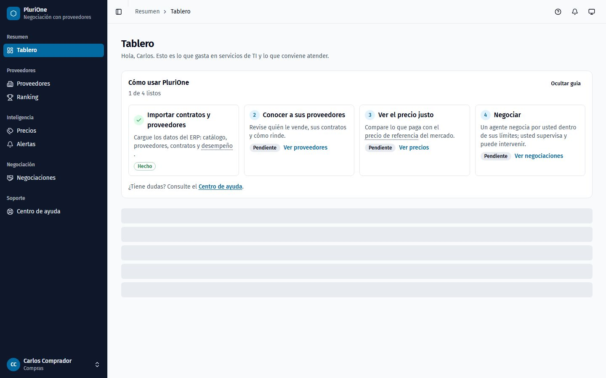

### 2.2 Consultar proveedores y precios

1. En **Proveedores**, busque por nombre o RFC, o filtre por categoría, estado o «En riesgo».
   Abra un proveedor para ver su puntuación (de 0 a 100), sus alertas, sus contratos y su
   desempeño mensual.

   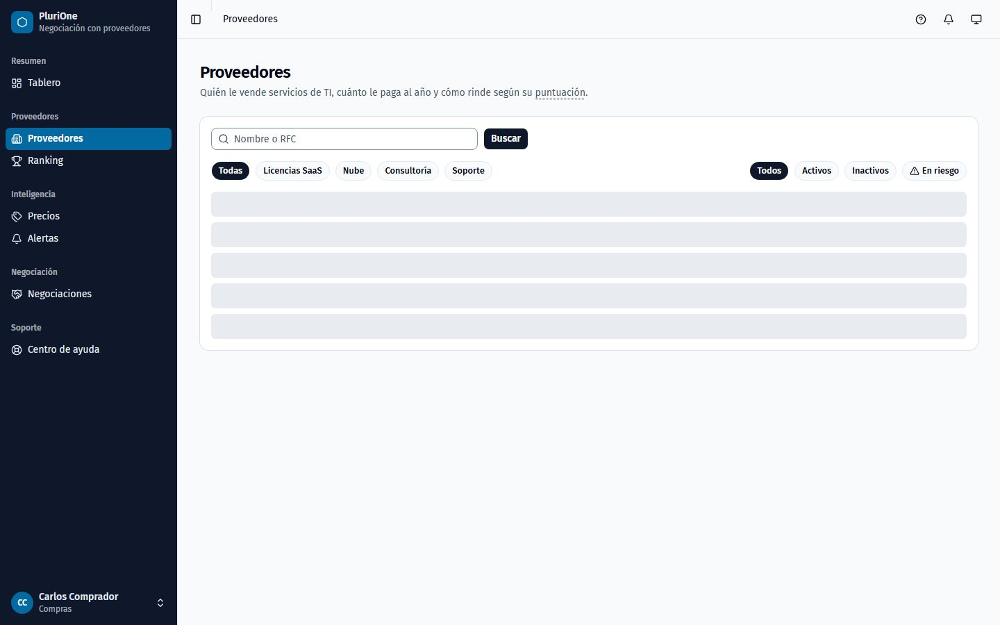
2. En **Precios**, elija un servicio, ajuste la cantidad y el plazo y pulse «Calcular». Verá el
   precio de referencia con tres valores: P25 (bajo), P50 (típico) y P75 (alto).

   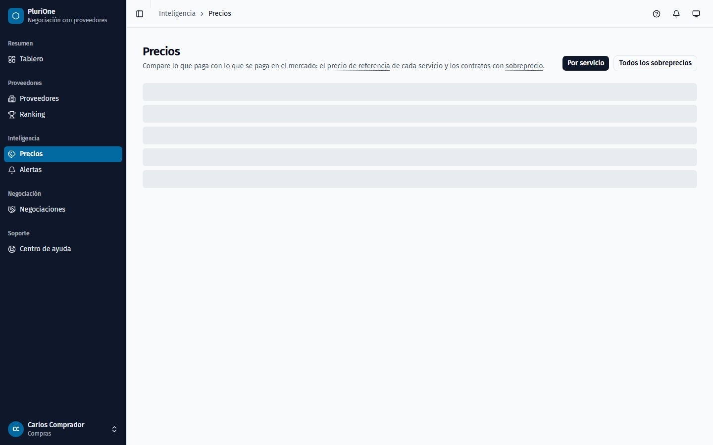
3. En **Alertas** están los sobreprecios, los contratos por vencer y los proveedores en riesgo.

### 2.3 Crear y publicar una negociación

1. En **Negociaciones**, pulse «Nueva negociación». Para renovar un contrato, use «Renovar» en el
   Tablero, en una alerta de vencimiento o en los contratos de la ficha del proveedor.
2. Escriba el título y la fecha límite, y revise las rondas (6 por defecto), el estilo del agente
   («Balanceado» por defecto) y el plazo del contrato.
3. Elija los servicios con su cantidad y los proveedores que invita (hasta 10). Pulse «Crear
   borrador».

   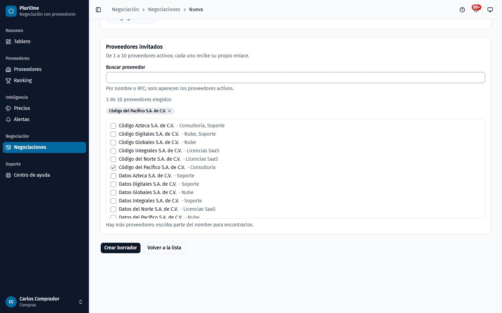
4. En el borrador, revise el **ideal** y el **límite** de cada servicio junto a la banda
   P25 · P50 · P75. El límite es lo más que está dispuesto a pagar; el agente nunca lo revela.
   Si queda arriba del P75, verá un aviso.

   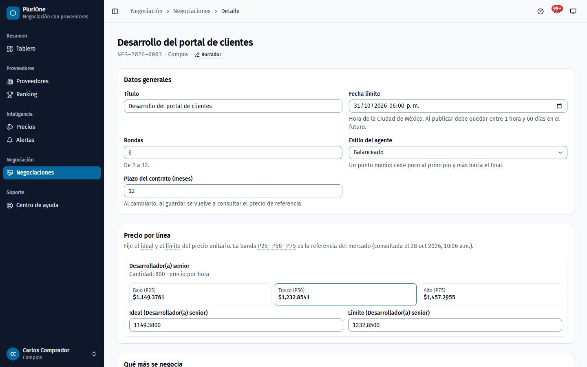
5. Si le importan otros términos (plazo, plazo de pago, SLA, tope de aumento o cuota de
   implementación), actívelos y reparta 100 puntos de peso entre ellos y el precio.
6. Pulse «Guardar cambios», después «Publicar», y confirme. Cada proveedor recibe su enlace por
   correo; usted lo ve **una sola vez** para copiarlo. Si un proveedor lo pierde, use «Reenviar»
   en la tabla de sesiones: el enlace anterior deja de servir.

   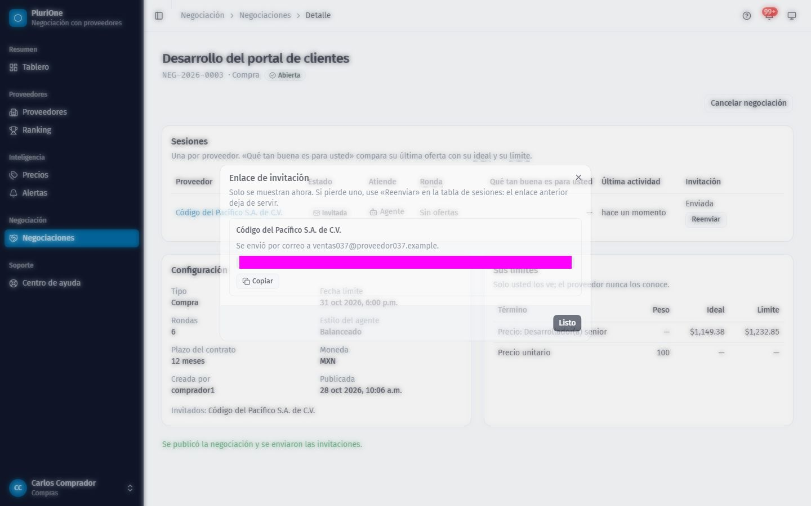

### 2.4 Supervisar e intervenir

- La negociación muestra una sesión por proveedor, con su estado, la ronda y qué tan buena es su
  última oferta para usted. Se actualiza sola cada pocos segundos.
- En cada sesión verá la conversación y las ofertas. En cada respuesta del agente,
  «¿Por qué respondió esto?» explica su decisión.
- Si el proveedor le escribió al agente con sus palabras, debajo de su mensaje verá qué entendió
  la plataforma («Interpretado: oferta · confianza 90 %») y, en cada respuesta, si la redactó el
  modelo de lenguaje o es una respuesta de plantilla.
- Con «Tomar el control» usted responde a mano: un mensaje, una contraoferta, aceptar la última
  oferta o cerrar sin acuerdo. Si lo que acepta o propone sale de sus límites, la plataforma le
  pide confirmarlo y lo marca para el aprobador. «Devolver al agente» le regresa la sesión.
- Si un proveedor pide hablar con una persona, su sesión aparece como «Escalada» hasta que usted
  la atienda y la devuelva.

  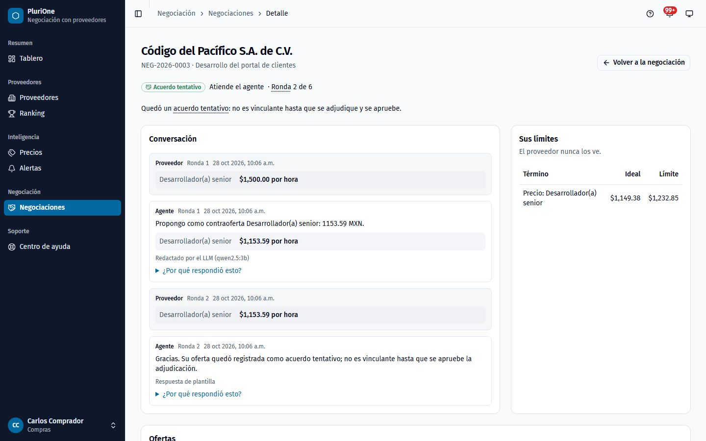

### 2.5 Adjudicar

1. Cuando vence la fecha límite o terminan todas las sesiones, la negociación pasa a
   «En evaluación». La sección «Evaluación» ordena los acuerdos del mejor al peor, marca el
   «Recomendado» y explica «Por qué se recomienda».

   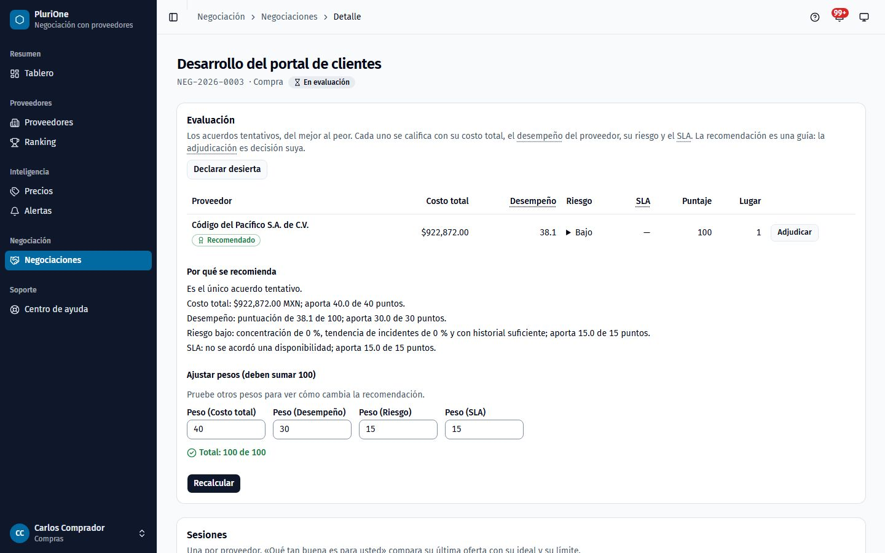
2. Pulse «Adjudicar» en la fila del proveedor que elija. Si no es el recomendado, escriba la
   justificación.
3. La confirmación dice si la adjudicación será directa o irá a un aprobador, y por qué. Pulse
   «Confirmar».

   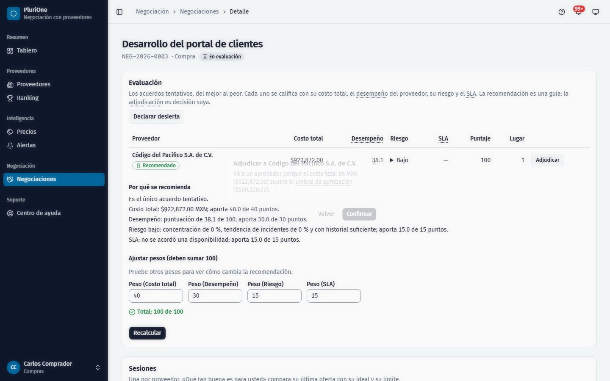
4. Si ningún acuerdo le conviene, pulse «Declarar desierta», escriba el motivo y confirme. No se
   puede deshacer.

Con la negociación «Adjudicada», la sección «Resultado» muestra quién propuso, quién aprobó y el
folio del contrato, que ya aparece en el historial del proveedor.

## 3. Proveedor

### 3.1 Entrar con su enlace

Abra el enlace de su correo de invitación. Es personal: no lo comparta. Deja de servir al llegar
la fecha límite, si compras se lo reenvía o si se cancela la negociación. El portal muestra qué
se negocia, la fecha límite, cuántas rondas le quedan y la conversación con el agente.

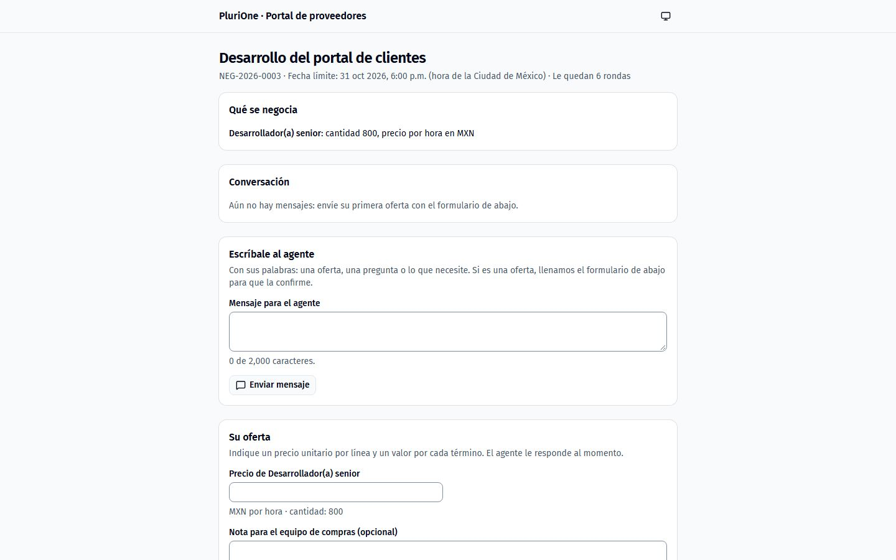

### 3.2 Enviar una oferta

1. En «Su oferta», escriba el precio unitario de cada servicio y el valor de cada término que se
   negocia.
2. Si quiere, deje una nota para el equipo de compras. La lee una persona; no cambia su oferta.
3. Pulse «Enviar oferta». El agente le responde al momento: acepta, le hace una contraoferta o
   cierra sin acuerdo. Si un precio parece un error de captura, le pide confirmarlo antes de
   responder, y eso no gasta una ronda.

   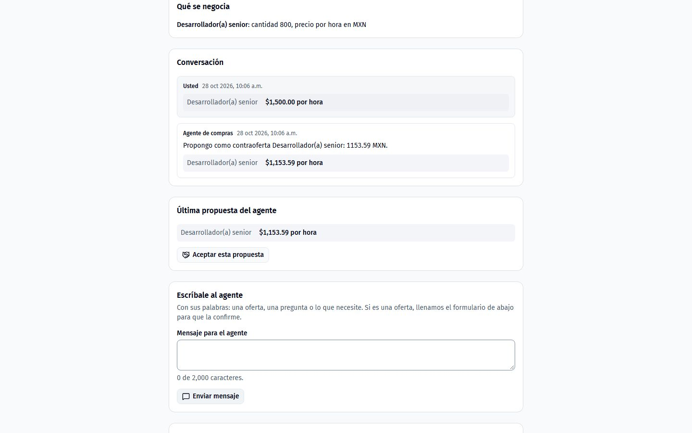
4. Para aceptar la última propuesta del agente, pulse «Aceptar esta propuesta», que llena el
   formulario, y después «Enviar oferta».

Si la negociación termina con un acuerdo, es tentativo: no es vinculante hasta que la empresa lo
adjudique y lo apruebe.

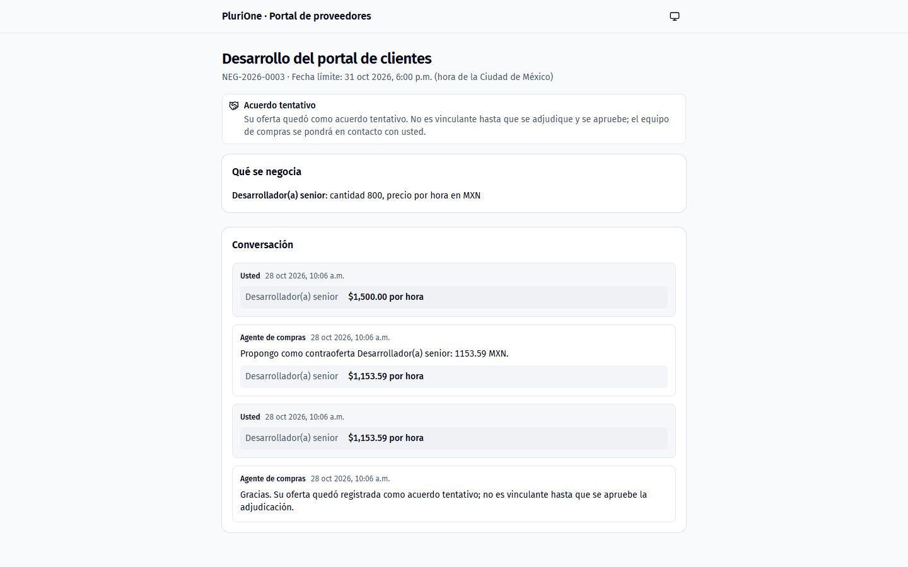

### 3.3 Escribirle al agente

En «Escríbale al agente» puede escribir con sus palabras una oferta, una pregunta o lo que
necesite, y pulsar «Enviar mensaje».

- Si su mensaje trae una oferta, la plataforma llena el formulario con lo que entendió. Revísela
  y pulse «Enviar oferta» para confirmarla: solo cuenta cuando usted la confirma.
- Si pregunta algo, el agente le contesta sin cambiar su oferta ni gastar una ronda.

  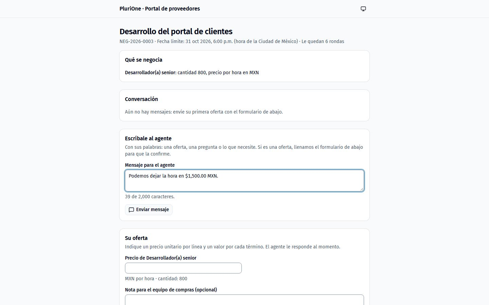

### 3.4 Hablar con una persona

Pulse «Hablar con una persona» en cualquier momento. Una persona de compras atenderá su sesión.

### 3.5 El resultado

Cuando la negociación se adjudica o se declara desierta, recibe un correo con el resultado que le
toca, y también lo ve en su portal mientras su enlace siga vigente. Ninguno de los dos dice quién
ganó ni muestra montos.

## 4. Aprobador

### 4.1 Encontrar lo que espera su aprobación

En el Tablero, la fila «Negociaciones» marca «Por aprobar» con el número de propuestas que
esperan. Pulse ese número, o abra Negociaciones: su lista empieza en «Por aprobar» si hay
propuestas esperando.

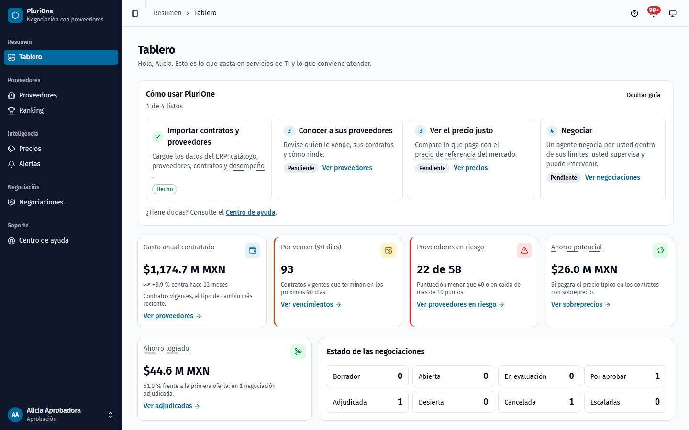

### 4.2 Aprobar o rechazar

1. Abra la negociación. Verá la evaluación con la propuesta resaltada, su justificación, las
   marcas «Fuera de límites» y el motivo por el que requiere aprobación (por ejemplo, «Supera el
   umbral de aprobación»).
2. Pulse «Aprobar» para adjudicar, o «Rechazar» y escriba el motivo.

   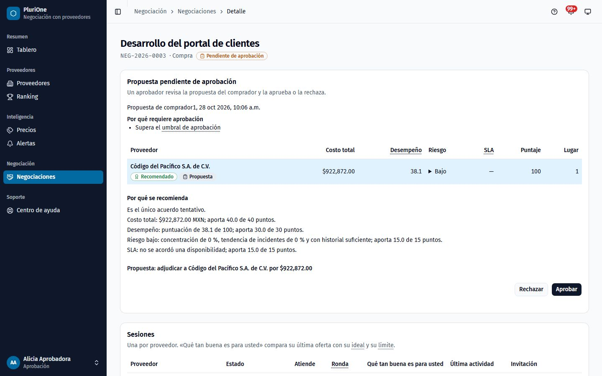

Al aprobar, la negociación queda «Adjudicada» y se registra el contrato. Al rechazar, vuelve a
«En evaluación» y compras puede proponer de nuevo o declararla desierta.

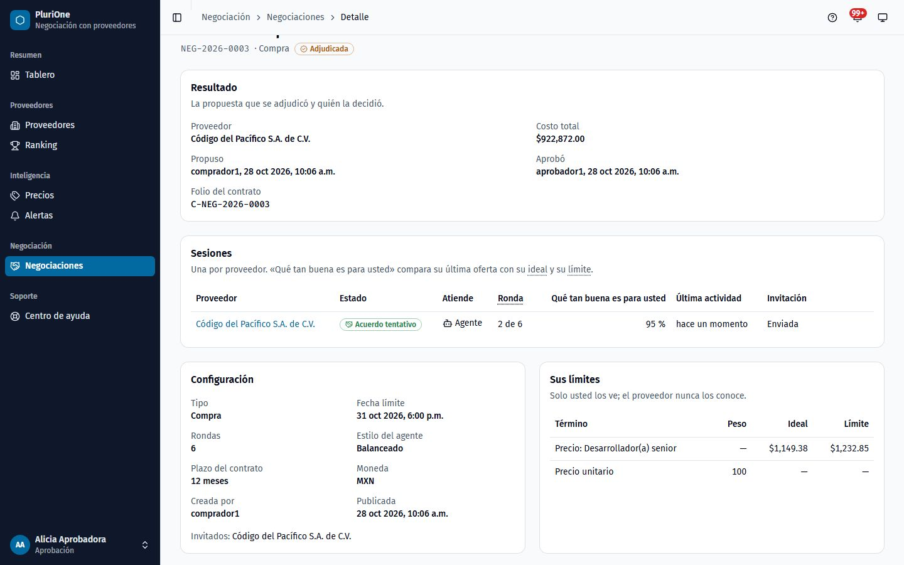

### 4.3 Reglas que conviene saber

- Una adjudicación va a un aprobador si su costo total supera el umbral (500,000 MXN, salvo que
  administración lo cambie) o si el acuerdo quedó fuera de los límites.
- Quien propone nunca aprueba su propia propuesta: aunque tenga los dos roles, no ve «Aprobar»
  ni «Rechazar» en ella.
- Si la propuesta cambió mientras la leía, la plataforma se lo dice y le pide revisar la nueva.

## 5. Administrador

El área **Sistema** del menú solo la ve el rol de Administración. Administración también ve las
negociaciones, pero no las cambia.

### 5.1 Panel de administración

Es la primera pantalla del área Sistema. Cada tarjeta lleva a la pantalla con el detalle:

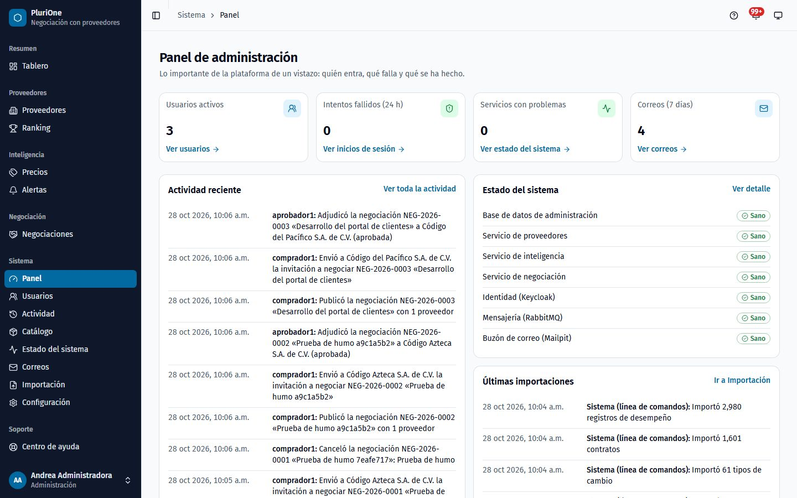

| Tarjeta | Qué muestra |
|---|---|
| Usuarios activos | Cuántas cuentas pueden entrar |
| Intentos fallidos (24 h) | Inicios de sesión rechazados del último día |
| Servicios con problemas | Piezas del sistema lentas o caídas |
| Correos (7 días) | Los correos de la última semana |
| Actividad reciente | Los últimos registros de la bitácora |
| Estado del sistema | El resumen de la sección 5.8 |
| Últimas importaciones | Los últimos archivos del ERP y su resultado |
| Datos y modelo | Cuántos proveedores, servicios, contratos, líneas de contrato, registros de desempeño y tipos de cambio hay, y el modelo de precios en uso |

### 5.2 Usuarios y roles

1. En **Usuarios**, pulse «Nuevo usuario».
2. Escriba el nombre, los apellidos y el correo; el usuario se sugiere a partir del correo.
3. Elija uno o más roles: Administración, Compras o Aprobación.
4. Elija cómo obtendrá su contraseña: por invitación (recomendada) o con una contraseña temporal
   que usted verá una sola vez.

- **Cambiar los roles:** desde la ficha de cada persona.
- **Protección:** nadie puede quitarse a sí mismo el rol de administración ni desactivarse, y
  siempre debe quedar al menos un administrador activo.
- **Desactivar:** las cuentas se desactivan, no se borran. La persona deja de entrar, sus
  sesiones se cierran y su historial se conserva. Puede activarla de nuevo cuando quiera.

  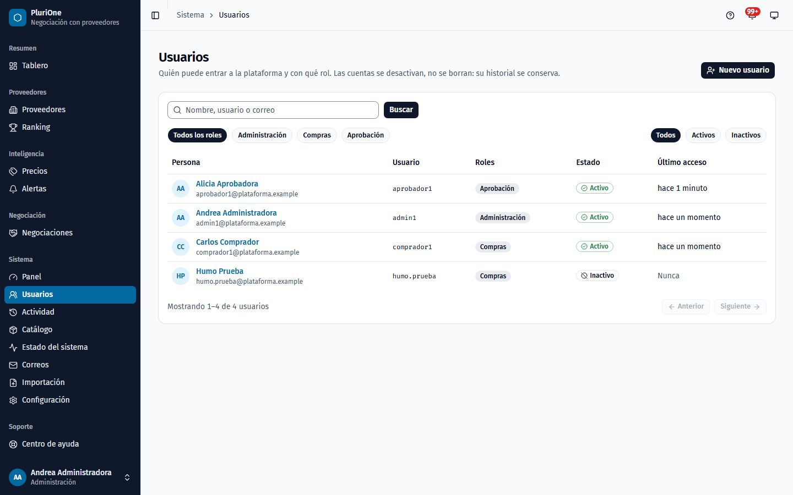

### 5.3 Contraseñas y correos del sistema

- **Invitación:** un correo con un enlace para que la persona defina su contraseña. Vence en
  72 horas.
- **Restablecimiento:** a quien ya entró antes se le envía un correo que vence en 24 horas.
- **Contraseña temporal:** se muestra una sola vez. Cópiela y entréguela por un medio seguro; la
  persona deberá cambiarla al entrar.
- **Correos:** muestra cada correo enviado y si salió bien. Incluye las invitaciones y los
  restablecimientos, y también las invitaciones a negociar y los resultados que se avisan a los
  proveedores («Resultado de negociación»).
  - Si el de una persona no salió, reintente desde su ficha o asígnele una contraseña temporal.
  - A una cuenta desactivada no se le puede enviar el correo: actívela primero.

    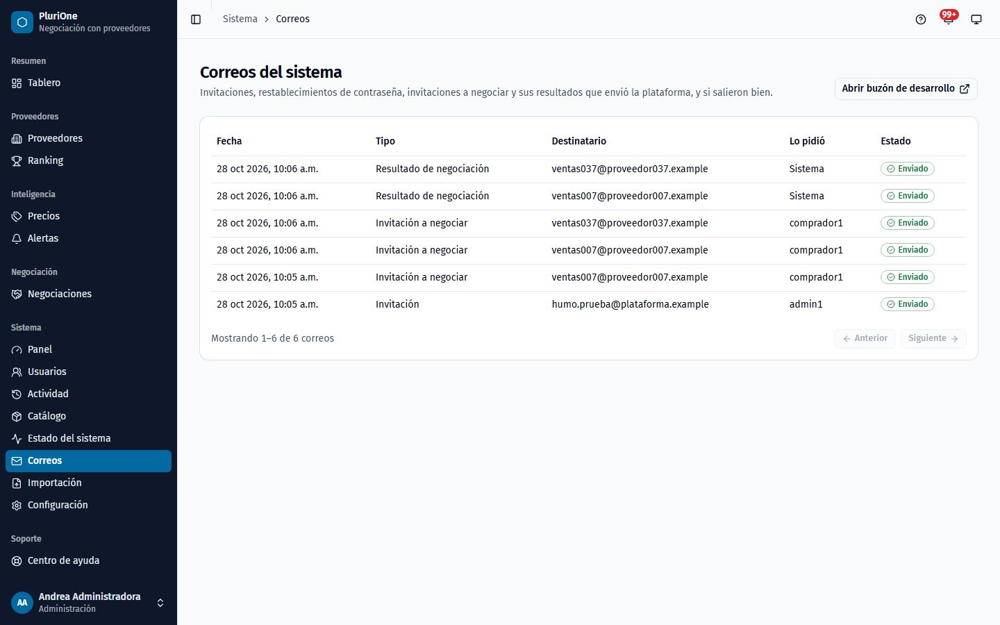

### 5.4 Actividad (bitácora) y su exportación

**Actividad** reúne lo que pasó en la plataforma, y nada de eso se puede borrar ni modificar:
- los inicios de sesión, incluidos los intentos fallidos;
- las acciones sobre usuarios;
- las importaciones y los cambios del catálogo;
- los cambios de la configuración y los entrenamientos del modelo de precios;
- las negociaciones: su publicación, cancelación, adjudicación o declaración de desierta, y los
  correos a los proveedores.

1. Filtre por persona, tipo y fechas.
2. Pulse «Exportar CSV» para descargar los registros filtrados y abrirlos en Excel. Se exportan
   como máximo los 10,000 más recientes: acote las fechas si necesita más.

   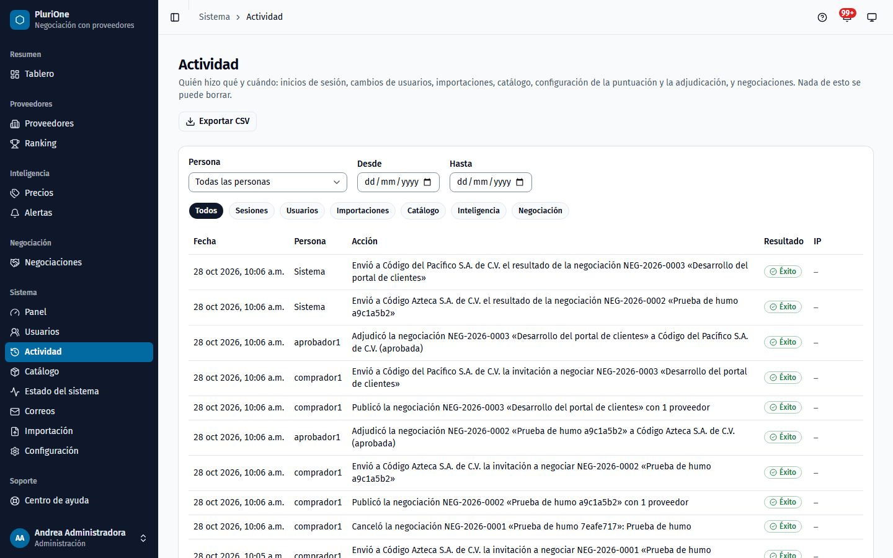

### 5.5 Catálogo de servicios

El catálogo lista los servicios que aparecen en los contratos y en Precios. Se dan de alta, se
editan o se desactivan en **Catálogo**, y también se cargan con la importación del ERP.

- El código no cambia después de crearlo: las importaciones lo usan para identificar el servicio.
- Si un servicio ya tiene contratos, tampoco se pueden cambiar su categoría, su unidad ni su
  moneda, porque los precios históricos dependen de ellas.
- Un servicio desactivado deja de aparecer en Precios, pero sus contratos y su historial se
  conservan.

  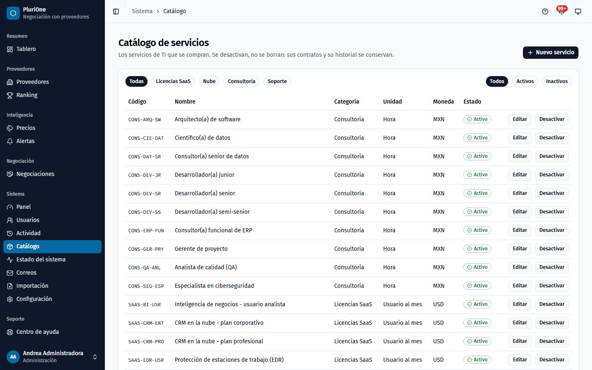

### 5.6 Importación de los datos del ERP

1. Abra **Importación**.
2. Elija el tipo de archivo, en este orden: catálogo de servicios, proveedores, tipo de cambio,
   contratos y desempeño. Contratos y desempeño se refieren a proveedores y servicios que ya
   deben estar importados.
3. Arrastre el archivo CSV o haga clic para elegirlo, y pulse «Importar». Se aceptan archivos
   CSV en UTF-8, separados por coma o por punto y coma, de hasta 10 MB.
4. Revise el resultado: filas leídas, registros guardados y omitidos.

**Si el archivo tiene errores, no se guarda ninguna fila:** la importación es todo o nada. Verá
una tabla con la fila, la columna y el problema de cada error. Corrija el archivo en su origen
(el ERP o la hoja de cálculo), guárdelo otra vez como CSV en UTF-8 y vuelva a importarlo con
«Elegir otro archivo». Cada intento, completo o rechazado, queda en la Actividad con quién lo
hizo.

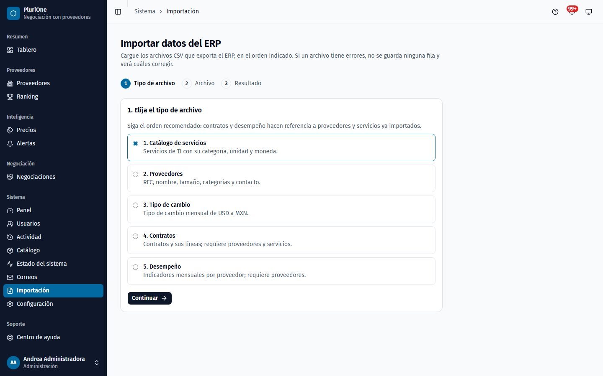

### 5.7 Configuración: puntuación, adjudicación y modelo de precios

**Puntuación de los proveedores:**
1. Abra **Configuración** en el área Sistema.
2. Reparta 100 puntos entre los cinco aspectos del desempeño; el total se muestra mientras
   escribe.
3. Fije el umbral de riesgo: un proveedor con menos puntos queda en riesgo y genera una alerta.
4. Ajuste la inflación anual que usa la línea base de precios y pulse «Guardar cambios».

Las puntuaciones, el ranking y las alertas se recalculan al guardar.

**Adjudicación:** la tarjeta «Adjudicación» fija cuánto pesa cada criterio al recomendar a quién
adjudicar (costo total, desempeño, riesgo y SLA, que deben sumar 100) y el umbral de aprobación
en MXN. Una adjudicación con un costo total mayor necesita un aprobador. Se guarda con «Guardar
adjudicación», aparte de la puntuación.

**Modelo de precios:**
- Se entrena solo cuando llegan 50 precios nuevos, y también puede reentrenarlo con «Reentrenar
  modelo de precios».
- Solo se usa si su error (MAPE) es menor que el de la línea base; si no, el precio de referencia
  sigue con la línea base.
- Si el modelo no se pudo cargar, por ejemplo después de una actualización, la página lo avisa y
  se usa la línea base hasta que lo reentrene.

Cada cambio de la configuración queda en la Actividad con quién lo hizo y qué campos cambió.

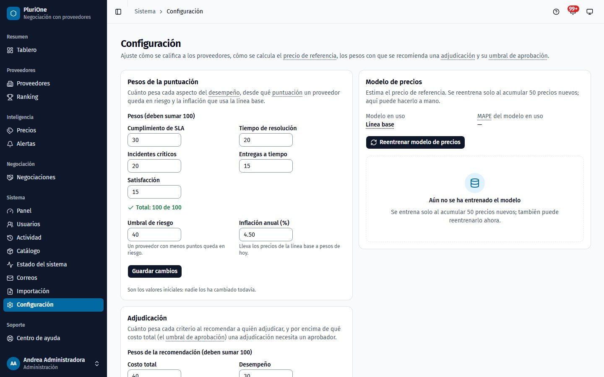

### 5.8 Estado del sistema

**Estado del sistema** comprueba cada 30 segundos estas piezas:
- la base de datos;
- los servicios de proveedores, de inteligencia y de negociación;
- la identidad (Keycloak);
- la mensajería (RabbitMQ);
- el buzón de correo.

| Estado | Qué significa |
|---|---|
| Sano | Responde en menos de un segundo |
| Con problemas | Responde con lentitud, o hay muchos mensajes pendientes en una cola |
| Caído | No responde en dos segundos, o responde con un error |

En la mensajería también avisa si un mensaje falló 5 veces y quedó apartado. Si un servicio sigue
caído, avise al equipo técnico con la hora y el detalle que muestra su tarjeta.

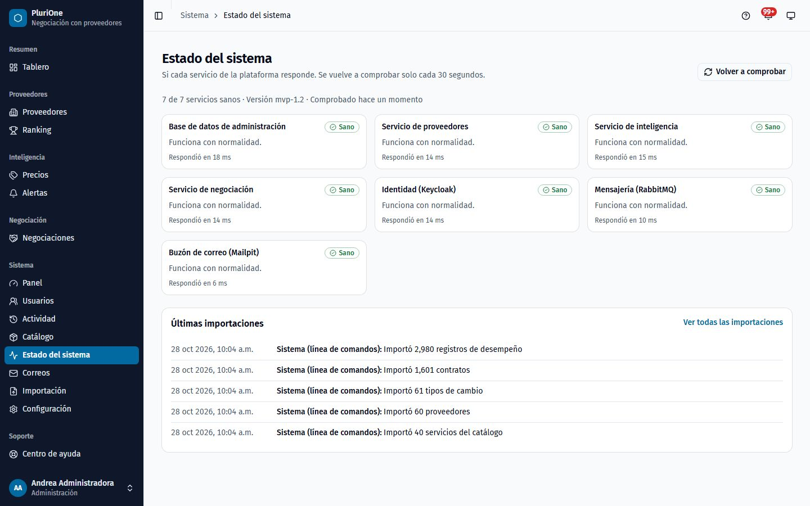

## 6. Preguntas frecuentes

**No puedo entrar a la plataforma.** Revise que su usuario y su contraseña sean correctos.
Después de varios intentos fallidos, la cuenta se bloquea unos minutos. Si olvidó su contraseña o
su cuenta está desactivada, pida ayuda a administración.

**Mi sesión se cerró sola.** Por seguridad, la sesión vence después de un tiempo. Vuelva a
iniciar sesión y regresará a la página donde estaba.

**No veo el área Sistema.** Es solo para el rol de Administración. Si necesita acceso, pídalo a
una persona con ese rol.

**¿Dónde cambio entre el tema claro y el oscuro?** Con el botón de tema de la barra superior:
claro, oscuro o el del sistema. La preferencia se guarda en ese navegador.

**Un proveedor dice que su enlace no sirve.** El enlace deja de servir al llegar la fecha límite,
si se reenvía o si se cancela la negociación. Si la negociación sigue abierta, use «Reenviar» en
la tabla de sesiones: le llega un enlace nuevo y el anterior deja de servir.

**¿El agente puede aceptar algo fuera de mis límites?** No. Nunca acepta fuera de los límites ni
los muestra al proveedor. Solo usted puede aceptar o proponer fuera de ellos, con «Tomar el
control», y entonces la plataforma lo marca para el aprobador.

**¿Qué pasa si el modelo de lenguaje no está disponible?** El agente sigue negociando igual: sus
cifras siempre las decide su motor, y los mensajes salen de plantillas. El proveedor puede seguir
ofertando con el formulario.

**La invitación no llegó** (administración). Revise en Correos si se envió. Si no salió,
reintente desde la ficha de la persona o asígnele una contraseña temporal. Pida también que
revise su carpeta de correo no deseado.

**¿Puedo borrar un usuario o un servicio?** (administración). No. Se desactivan, para conservar
su historial y la bitácora, y se pueden activar de nuevo cuando quiera.

## Cómo se actualizan las capturas

Las toma `web/e2e/capturas-manual.e2e.ts`. Con el stack levantado
(`uv run python infra/arrancar.py`), sigue el recorrido de demostración de
[`docs/MVP.md`](../MVP.md) con los usuarios de desarrollo y vuelve a guardar las imágenes en
`docs/manuales/img/`:

```bash
cd web
npx playwright test capturas-manual
```

El enlace de invitación sale tapado en su captura. Conviene correrlo sobre un stack recién creado
para que los números sean los de un solo recorrido.

## Pendientes de este manual

- Una revisión con una persona de compras de PluriOne antes de la capacitación (entregable 9).
