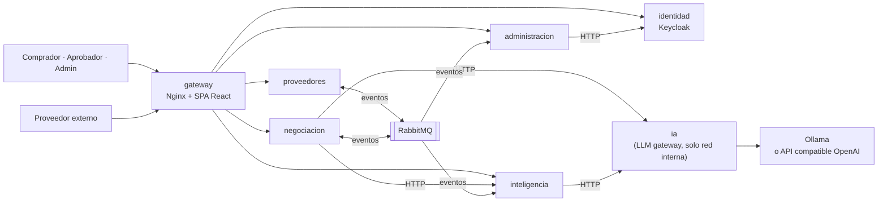
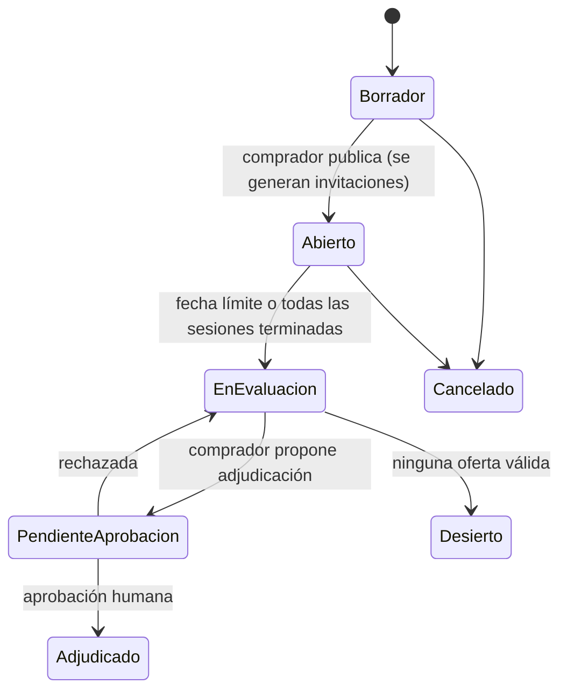
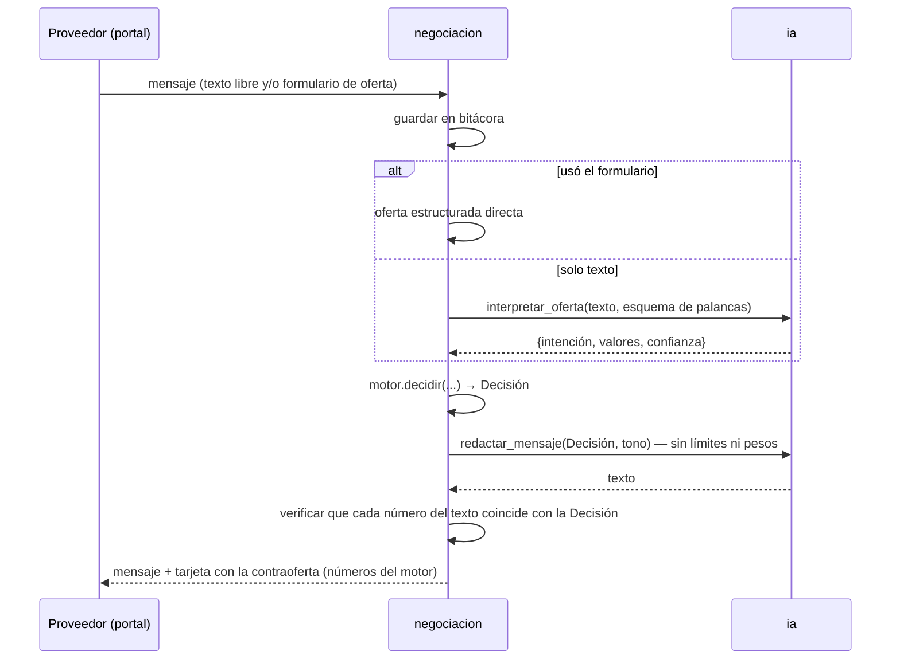

# PRD y especificación de diseño — Plataforma de Negociación Automática con Proveedores

| Campo | Valor |
|---|---|
| Proyecto | 064 — Residencias profesionales ITH |
| Empresa | PluriOne S.A. de C.V. (Develop Talent & Technology) |
| Asesor empresarial | Juan Méndez Herrera |
| Líder de proyecto / evaluaciones | Edgar Loheffelmman |
| Fecha de inicio | 2026-09-28 |
| Estado | ✅ Aprobado por el residente (2026-09-28). Secciones 1–3 aprobadas una por una; 4–8 aprobadas en la revisión del documento completo |

Este documento corresponde al entregable **"Documento de requerimientos"** del cronograma y es la base de la propuesta técnica, el documento de arquitectura y el plan del proyecto.

---

## 0. Contexto y decisiones de partida

Decisiones tomadas con el residente durante la fase de descubrimiento:

| # | Pregunta | Decisión |
|---|---|---|
| D1 | ¿Para qué se usará la plataforma? | Calidad de producción, como si se fuera a usar de verdad. Los datos serán **simulados pero realistas**. |
| D2 | ¿Stack obligatorio? | No. Las tecnologías del documento base son orientativas; se eligen por mérito. |
| D3 | ¿Qué tan "automática" es la negociación? | **Híbrida**: copiloto del comprador + portal donde el proveedor negocia con un agente IA dentro de límites fijados por el comprador. **Todo cierre requiere aprobación humana.** |
| D4 | ¿Una empresa o varias? | **Una sola empresa compradora** (single-tenant). Otra implantación = otra instancia. |
| D5 | ¿Dominio de compras? | **Servicios de TI**: licencias SaaS, nube, consultoría y soporte. |
| D6 | ¿Presupuesto de infraestructura? | **Costo cero**: todo corre local con Docker; LLM local con Ollama. Opcional: API gratuita compatible con OpenAI cambiando solo configuración. |
| D7 | ¿Tiempo disponible? | ~4 meses a tiempo completo (16–18 semanas), un desarrollador. |
| D8 | ¿Estilo de arquitectura? | **Microservicios** (elegido sobre monolito modular y sobre agente LLM-first; ver ADR-001 en la sección 6). |
| D9 | ¿Cómo se revisa el diseño? | Secciones 1–3 aprobadas una por una; el residente pidió completar el resto sin aprobación intermedia y revisar el documento completo al final. |

**Hardware de desarrollo:** Ryzen 5 5600H, 14 GB RAM, RTX 3050 Ti Laptop (4 GB VRAM). Consecuencia: modelos locales de 3–4B parámetros (p. ej. Qwen3 4B, Gemma 3 4B cuantizados) — buenos para interpretar y redactar texto, **no fiables para decidir precios**.

**Principio rector — "el LLM habla, el motor decide":** toda decisión con dinero (ofertas, contraofertas, concesiones, aceptación, adjudicación) la toma código determinista y probado. El LLM solo (a) convierte el mensaje del proveedor en una oferta estructurada y (b) redacta mensajes y explicaciones. Esto hace el sistema medible y resistente a manipulación (prompt injection) por parte del proveedor.

---

## 1. Visión, usuarios y alcance — ✅ Aprobada

### 1.1 Problema

Una empresa mediana que compra servicios de TI negocia a mano, con información dispersa en correos y hojas de cálculo. Consecuencias típicas:

- Renovaciones con aumentos automáticos que nadie cuestiona.
- El comprador no sabe cuál es un "precio justo" para una licencia o una tarifa de consultoría.
- La elección de proveedor es subjetiva y no queda documentada.
- No hay trazabilidad de qué se ofreció, qué se concedió y por qué.

### 1.2 Roles

| Rol | Tipo | Qué hace |
|---|---|---|
| Administrador | Interno | Usuarios, catálogos, pesos de criterios, umbrales de aprobación, importación de datos. |
| Comprador | Interno | Crea eventos de negociación, fija límites, supervisa al agente, propone adjudicación. |
| Aprobador | Interno | Gerente de compras / finanzas. Aprueba cierres y adjudicaciones sobre el umbral. |
| Proveedor | Externo | Accede con enlace de invitación (sin cuenta), hace ofertas y negocia con el agente. |

### 1.3 Capacidades del MVP

1. **Proveedores, contratos e historial** de compras. Importación por CSV/API como adaptador de un ERP/SRM simulado.
2. **Inteligencia de precios**: "precio justo" por servicio (línea base estadística + modelo ML); alertas de sobreprecio y de renovaciones próximas.
3. **Desempeño del proveedor**: cumplimiento de SLA, tiempo de resolución, incidentes, entregas a tiempo y satisfacción → puntuación.
4. **Eventos de negociación** (cotización nueva o renovación): líneas, proveedores invitados, precio objetivo, precio límite (walk-away), palancas negociables con prioridad y fecha límite.
5. **Negociación con agente IA** en el portal del proveedor, con escalamiento a humano. Nunca cierra sin aprobación.
6. **Propuestas de negociación**: documento de estrategia y argumentos para cuando el comprador negocia manualmente.
7. **Recomendación de adjudicación** multicriterio y explicable (costo total, desempeño, riesgo, SLA) con pesos configurables.
8. **Simulador de escenarios**: volumen, plazo, proveedor, tipo de cambio, tope de aumento → comparación de costo total.
9. **Aprobaciones y bitácora de auditoría** inmutable.
10. **Tablero**: ahorros, contratos por vencer, desempeño de proveedores, estado de negociaciones.

**Palancas de negociación del dominio (servicios de TI):** precio por usuario/licencia, descuento por volumen, plazo del contrato, tope de aumento en renovación, niveles de SLA y penalizaciones (créditos de servicio), tarifas por rol de consultoría, horas de soporte incluidas, cuota de implementación, plazo de pago.

### 1.4 Fuera de alcance (v1)

- Integración con ERP y correo reales (se simulan con adaptador de importación y buzón local de desarrollo).
- Multi-empresa (multi-tenant).
- Firma electrónica de contratos, órdenes de compra y pagos.
- Búsqueda semántica sobre PDFs de contratos (RAG).
- App móvil.
- Power BI (se deja endpoint/exportación para conectarlo después).
- Idiomas distintos al español.

### 1.5 Pieza de validación: simulador de proveedores

Bots que actúan como proveedores contra la API pública del portal, cada uno con un **precio de reserva oculto** y un estilo (duro, flexible, errático, manipulador). Permiten *medir* el agente sin proveedores reales y alimentan el reporte de QA. El bot "manipulador" intenta prompt injection.

### 1.6 Métricas de éxito

| Métrica | Meta |
|---|---|
| Acuerdos fuera de los límites del comprador (incluye intentos de manipulación) | **0** |
| Ahorro frente a la primera oferta, contra los bots | ≥ 8 % promedio |
| Tasa de acuerdo contra los bots | ≥ 70 % |
| Error del benchmark de precios (MAPE sobre datos de prueba) | ≤ 15 % |
| Adjudicación: acierto sobre el proveedor de mayor calidad latente del generador | ≥ 85 % |
| Campos de oferta interpretados correctamente por el LLM (conjunto etiquetado, ver 4.8) | ≥ 90 % |
| Filtraciones del precio límite o de los pesos ante la suite de ataques | **0** |
| Respuesta del agente, percentil 95, en el equipo de desarrollo | < 20 s |
| Cobertura de pruebas en los motores de dominio | ≥ 80 % |

---

## 2. Arquitectura: servicios y comunicación — ✅ Aprobada

### 2.1 Mapa de servicios



| Servicio | Tecnología | Responsabilidad | Datos propios |
|---|---|---|---|
| **gateway** | Nginx | Único punto de entrada. Enruta `/api/<servicio>`, sirve la SPA, limita tasa de peticiones, cabeceras de seguridad, genera `X-Request-ID`. | — |
| **identidad** | Keycloak (solo configuración, sin código propio) | Usuarios internos y roles; login OIDC; emite JWT (RS256) con JWKS público. Equivalente a Entra ID: migrar = cambiar emisor OIDC. | `keycloak_db` |
| **proveedores** | FastAPI | Proveedores, catálogo de servicios TI, contratos, historial de precios, KPIs de desempeño, importación CSV (adaptador ERP/SRM). | `proveedores_db` |
| **administracion** | FastAPI | Usuarios y roles (vía la API de Keycloak), bitácora de actividad de solo inserción, correos del sistema, estado de los servicios y panel de administración. | `administracion_db` |
| **inteligencia** | FastAPI + scikit-learn | Precio justo (línea base y modelo por cuantiles), puntuación de proveedores, alertas y KPIs del Tablero, a partir de una copia local alimentada por eventos; después, recomendación de adjudicación y simulador de escenarios. | `inteligencia_db` (copia local, configuración y registro de modelos) y el volumen `modelos` (artefactos) |
| **negociacion** | FastAPI | Eventos de negociación, límites, sesiones por proveedor, **motor de concesiones**, API del portal del proveedor (tokens de invitación), propuestas de negociación, aprobaciones, bitácora de auditoría. | `negociacion_db` |
| **ia** | FastAPI | Único acceso al LLM: plantillas de prompt versionadas, salidas estructuradas validadas con esquema, cola de concurrencia hacia la GPU, timeouts, cambio de proveedor LLM por configuración, métricas de tokens y latencia. **No expuesto por el gateway.** | Sin estado |
| **web** | React + TypeScript (Vite) | Panel de comprador/aprobador/admin y portal del proveedor en una sola SPA (rutas separadas). | — |

**Infraestructura compartida:** PostgreSQL (una instancia, una base de datos y un usuario por servicio), RabbitMQ (exchange tipo *topic* `eventos`), Ollama.

**Herramientas fuera de producción** (`tools/`): generador de datos sintéticos y simulador de proveedores (bots).

**Por qué `ia` es un servicio aparte:** la GPU local es un recurso escaso (1–2 peticiones concurrentes). Un solo servicio controla la cola, el modelo activo y las métricas; lo consumen `negociacion` e `inteligencia`.

### 2.2 Reglas de comunicación

1. **Ningún servicio lee la base de datos de otro.** Cada usuario de BD tiene permisos solo sobre la suya.
2. **HTTP síncrono solo para consultas que necesitan respuesta inmediata**: `negociacion → inteligencia` (benchmark, recomendación), `negociacion → ia`, `inteligencia → ia`. Sin ciclos. Toda llamada tiene timeout, reintentos con backoff y comportamiento de degradación definido (sección 5).
3. **Eventos asíncronos para propagar cambios de estado.** Cada servicio guarda copia local de lo que necesita (p. ej. `inteligencia` mantiene su historial a partir de eventos de `proveedores`).
4. **Entrega fiable:** patrón *transactional outbox* (el evento se guarda en la misma transacción que el cambio y un proceso lo publica), entrega *al menos una vez*, **consumidores idempotentes** (registro de `event_id` procesados) y cola de mensajes fallidos (*dead letter*).
5. **Contratos documentados:** OpenAPI por servicio (FastAPI). Los tipos de evento, las colas y sus bindings se declaran en `libs/comun/src/comun/topologia.py`, y una prueba verifica que `infra/rabbitmq/definitions.json` diga lo mismo.

**Sobre de evento (envelope):** `event_id`, `type`, `version`, `occurred_at`, `correlation_id`, `payload`.

**Eventos iniciales:**

| Evento | Publica | Consume | Para qué |
|---|---|---|---|
| `proveedor.actualizado` | proveedores | negociacion, inteligencia | Copia local de nombre/contacto/estado del proveedor. |
| `contrato.registrado` | proveedores | inteligencia | Historial de precios y condiciones. |
| `desempeno.registrado` | proveedores | inteligencia | KPIs para puntuación. |
| `negociacion.adjudicada` | negociacion | proveedores, inteligencia | Crear contrato nuevo y actualizar historial. |
| `servicio.actualizado` | proveedores | administracion, inteligencia, negociacion | Cambios del catálogo (con quién los hizo) y copia local del servicio, también al importar el catálogo. |
| `importacion.completada` · `importacion.rechazada` | proveedores | administracion | Bitácora de importaciones con quién las hizo. |
| `tipo_cambio.registrado` | proveedores | inteligencia | Tipo de cambio mensual para llevar los montos a MXN. |
| `configuracion.actualizada` | inteligencia | administracion | Bitácora de los cambios de pesos, umbral e inflación. |
| `modelo.entrenado` | inteligencia | administracion | Bitácora de cada entrenamiento del modelo de precios. |
| `negociacion.publicada` · `negociacion.cancelada` | negociacion | administracion | Bitácora de las negociaciones publicadas y canceladas, con quién lo hizo. |
| `negociacion.invitacion_enviada` | negociacion | administracion | Bitácora y página Correos de cada invitación a negociar (enviada o fallida). |

Colas: `inteligencia.eventos`, `administracion.actividad` y `negociacion.eventos`, *quorum* con 5 entregas como máximo; lo que falla 5 veces pasa a `<cola>.dlq` (detalle en `docs/superpowers/specs/2026-10-10-servicio-inteligencia-design.md`, §3) (N1 en `docs/superpowers/specs/2026-10-13-negociacion-determinista-design.md`, §9).

Cierra el ciclo: una negociación adjudicada genera un contrato, que mejora el benchmark de la siguiente negociación.

### 2.3 Estructura del repositorio (monorepo, workspace de uv)

```
/
├─ services/
│  ├─ proveedores/     (app/, tests/, alembic/, Dockerfile, pyproject.toml)
│  ├─ inteligencia/
│  ├─ negociacion/
│  └─ ia/
├─ libs/comun/         (validación JWT contra JWKS, logs JSON con request-id, envelope + outbox, settings base)
├─ web/                (React + TypeScript)
├─ infra/              (docker-compose, nginx.conf, realm de Keycloak, init de PostgreSQL)
├─ tools/              (generador de datos, simulador de proveedores)
├─ docs/               (specs, arquitectura C4, ADRs, manuales)
└─ .github/workflows/
```

**Estructura interna de cada servicio:** `app/dominio/` contiene la lógica pura sin I/O (motores de concesiones, puntuación, simulación), probada con tests unitarios rápidos. `app/api/`, `app/datos/` y `app/eventos/` son adaptadores delgados alrededor del dominio. `libs/comun` solo contiene infraestructura transversal, nunca modelos de dominio, para no acoplar servicios.

### 2.4 Presupuesto de recursos (equipo de desarrollo)

| Componente | RAM aprox. |
|---|---|
| Keycloak | 600–800 MB |
| PostgreSQL | 150–250 MB |
| RabbitMQ | ~150 MB |
| 4 servicios Python | ~500 MB |
| Nginx | ~10 MB |
| Ollama + modelo 4B cuantizado | ~1 GB RAM + ~3 GB VRAM |
| **Total** | **~3–3.5 GB RAM** (cabe en 14 GB junto con IDE y navegador) |

---

## 3. Flujo de negociación y motor de concesiones — ✅ Aprobada

### 3.1 Ciclo de vida

Un **evento de negociación** agrupa una compra (cotización nueva con varios proveedores) o una renovación (un solo proveedor, el actual). Dentro del evento hay una **sesión** por proveedor invitado; el agente negocia las sesiones en paralelo.



Estados de cada sesión: `Invitada → Activa → {AcuerdoTentativo | SinAcuerdo | Expirada | Escalada}`. `Escalada` pasa a manos del comprador, quien puede devolverla al agente.

**Nada es vinculante hasta la adjudicación aprobada.** Un *acuerdo tentativo* es la mejor oferta confirmada del proveedor dentro de los límites; la adjudicación elige entre acuerdos tentativos y siempre la aprueba un humano (el aprobador si el monto supera el umbral; si no, el propio comprador).

### 3.2 Configuración del evento (comprador)

- **Tipo:** compra nueva o renovación.
- **Líneas:** servicio del catálogo, cantidad (usuarios, horas), unidad y plazo en meses.
- **Límites sugeridos por `inteligencia`:** a partir del benchmark (percentiles P25/P50/P75 del precio justo) se sugiere precio objetivo ≈ P25 y precio límite ≈ P50–P60. En renovaciones el límite nunca supera el precio vigente + tope de aumento. El comprador puede ajustarlos; el sistema advierte si el límite queda sobre P75.
- **Palancas negociables:** para cada una, valor ideal, peor valor aceptable (límite duro) y peso de importancia.
- **Estilo del agente:** firme, balanceado o flexible (parámetro β, ver 3.3).
- **Rondas máximas** (por defecto 6) y fecha límite.
- **Invitaciones:** un enlace por sesión con token de invitación que expira en la fecha límite (detalle en 5.1).
- **Propuesta de negociación:** documento con la estrategia (precio justo, historial del proveedor, palancas y argumentos) redactado por `ia` sobre datos calculados por `inteligencia`. Sirve también para negociar manualmente.

### 3.3 Motor de concesiones (dominio puro, determinista)

**Utilidad multiatributo.** Cada oferta es un vector de términos (precio por línea, plazo, plazo de pago, SLA, tope de aumento, horas de soporte…). Su utilidad para el comprador es:

`U(oferta) = Σ wᵢ · uᵢ(xᵢ)`, con `uᵢ` lineal entre el peor valor aceptable (0) y el ideal (1).

Una oferta que viola cualquier límite duro es **inválida** sin importar su utilidad.

**Utilidad objetivo por ronda** (estrategia dependiente del tiempo de Faratin et al.):

`U_obj(t) = 1 − (t / T)^(1/β)`

- `T` = rondas máximas.
- β < 1 concede tarde (Boulware). Valores por defecto: firme = 0.3, balanceado = 0.6, flexible = 1.0.
- Se calibran con el simulador de proveedores.

**Contraoferta:** se interpola entre la última oferta del proveedor `s` y el ideal del comprador `I`: `o(α) = s + α·(I − s)`. Se busca por bisección el α con `U(o(α)) = U_obj(t)` y luego se ajusta a límites duros y a unidades válidas (centavos, meses enteros). Así la contraoferta queda lo más cerca posible de lo que pidió el proveedor.

> **Precisión de N1** (`docs/superpowers/specs/2026-10-13-negociacion-determinista-design.md`, §6.4): el camino de la contraoferta va de la oferta acotada a los límites (`s′`), a la oferta con la curva propia del agente en los términos que cruzaban un límite (`s̃`; así no contesta con el límite antes de la ronda `T`), y de ahí a `I′`: el ideal, salvo en los términos donde la oferta ya era mejor que el ideal, que se quedan con el valor ofrecido. La curva se redondea hacia el ideal; el resultado, al valor más cercano, salvo que eso suba la utilidad sobre la contraoferta anterior, en cuyo caso se redondea hacia la oferta del proveedor. La regla completa está en ese §6.4.

**Invariantes probadas por tests:**
- El agente nunca retrocede en sus concesiones: la utilidad de sus contraofertas no aumenta de una ronda a otra, con las dos excepciones acotadas de N1 (spec N1, §6.7): la contraoferta `s̃` de una oferta inválida cuyo `s′` ya alcanza el objetivo y, a lo sumo, un paso de precisión cuando un término que cruzaba su límite caería en él.
- Nunca propone ni acepta nada fuera de los límites.

**Regla de aceptación:** se acepta, como *acuerdo tentativo*, si `U(oferta del proveedor) ≥ U(contraoferta que el agente haría en la siguiente ronda)` y la oferta es válida. En la última ronda se pide "mejor y última oferta": se acepta si es válida y si no, termina sin acuerdo.

**Presión competitiva:** en compras con varios proveedores, el motor calcula `hay_mejor_oferta` (booleano). El agente puede decir "hay ofertas más competitivas", pero **nunca revela montos ni nombres**.

**Ejemplo** (solo precio; objetivo 30 USD, límite 35 USD por usuario/mes; T = 6; β = 0.6):

| Ronda | U_obj | Contraoferta del agente |
|---|---|---|
| 0 | 1.00 | 30.00 |
| 2 | 0.84 | 30.80 |
| 4 | 0.49 | 32.54 |
| 5 | 0.26 | 33.69 |
| 6 | 0.00 | 35.00 (límite) |

Si el proveedor ofrece 32.00 en la ronda 4, el agente acepta de forma tentativa, porque su siguiente contraoferta (33.69) sería peor para el comprador.

**Salida del motor:** `decidir(estado_sesion, oferta, config) → Decisión`, donde la Decisión es una de `Aceptar | Contraofertar(valores) | PedirAclaracion | Escalar | CerrarSinAcuerdo`, junto con la traza del cálculo (utilidades, ronda, β). La traza se guarda en la bitácora, lo que hace explicable cada movimiento.

### 3.4 Un turno de negociación



**Reglas de seguridad del turno:**

1. **El LLM que redacta nunca recibe** el precio límite, los pesos ni la utilidad. No puede filtrar lo que no conoce.
2. **Verificación numérica:** si el texto generado contiene un número que no coincide con la Decisión, se regenera una vez. Si vuelve a fallar, se usa una **plantilla determinista**.
3. **Confirmación estructurada:** ningún acuerdo tentativo se registra a partir de texto interpretado. El proveedor debe confirmar los valores exactos en la tarjeta o el formulario. Si una inyección de prompt engaña al intérprete, el proveedor ve números que no ofreció y no puede confirmarlos por error sin darse cuenta.
4. **Rango de cordura:** los valores interpretados fuera de 0.1×–10× del benchmark provocan una petición de aclaración.
5. **Degradación:** si `ia` no responde, el motor decide igual. El mensaje sale de la plantilla y el texto libre se reemplaza por "use el formulario de oferta". **El sistema negocia aun con el LLM caído.**

**Disparadores de escalamiento:** el proveedor pide hablar con una persona; solicita términos fuera de las palancas modeladas; hay 2 interpretaciones fallidas seguidas; se detecta lenguaje abusivo o un intento de manipulación (se marca para revisión aunque sea inofensivo).

### 3.5 Supervisión humana y adjudicación

- El comprador ve las sesiones en vivo y puede **pausar al agente, tomar el control y devolverlo**. Las ofertas manuales fuera de los límites requieren confirmación explícita y quedan marcadas para el aprobador.
- Al pasar a `EnEvaluacion`, `inteligencia.recomendar()` ordena los acuerdos tentativos por costo total, desempeño, riesgo y SLA, con explicación en lenguaje natural.
- El comprador propone la adjudicación. **Si se aparta de la recomendación, debe justificarlo** (queda en bitácora).
- Tras la aprobación, se publica `negociacion.adjudicada` y los proveedores no elegidos reciben aviso en el portal.

> **Desviación de 4′ (D9)** (`docs/superpowers/specs/2026-10-16-adjudicacion-y-aprobacion-design.md`, §4.6): el aviso del resultado va por correo a cada proveedor invitado que tenga destinatario y, si su enlace sigue vigente, también en el portal. El enlace vence en la fecha límite (§5.1) y la adjudicación casi siempre llega después, así que avisar solo en el portal no llegaría a nadie. El aviso va también al proveedor elegido y a los de una negociación desierta; dice cuál fue el resultado para él y nunca nombra al ganador ni revela montos.

### 3.6 Bitácora de auditoría

Tabla de solo inserción. A nivel de base de datos, el usuario del servicio **no tiene permisos UPDATE ni DELETE** sobre ella. Registra cada mensaje, interpretación, decisión del motor con su traza y versión de configuración, y acción humana. Permite reproducir y explicar cualquier negociación: "¿por qué el agente ofreció 32.54 en la ronda 4?".

---

## 4. Datos simulados y modelos analíticos

### 4.1 Entidades principales por servicio

| Servicio | Entidades |
|---|---|
| proveedores | Proveedor, ServicioCatalogo, Contrato, LineaContrato, RegistroDesempeno, TipoCambio, Outbox, EventoProcesado |
| inteligencia | Proveedor, Servicio, TipoCambio, Contrato, LineaContrato y Desempeno (copia local alimentada por eventos), Configuracion, ModeloBenchmark (registro de modelos), Outbox, EventoProcesado; Escenario (más adelante) |
| negociacion | Evento, Linea, Palanca, Sesion, Mensaje, Oferta (origen: formulario / texto; fuera de límites confirmada sí/no), Bitacora (incluye la traza de cada decisión del motor), Proveedor y Servicio (copias), Outbox, EventoProcesado; Adjudicacion y Aprobacion (incremento 4) |
| administracion | Actividad (bitácora de solo inserción), CorreoEnviado, CursorEventos |

**Reglas de datos:**
- Dinero en `NUMERIC(14,4)` + código de moneda; `Decimal` en Python. Nunca `float`.
- Fechas en UTC (`timestamptz`), mostradas en `America/Mexico_City`.
- La utilidad del motor se calcula en punto flotante, pero toda oferta final se redondea a centavos en `Decimal`.

### 4.2 Generador de datos sintéticos (`tools/generador`)

- **Reproducible** (semilla fija) y de tamaño configurable. Por defecto: 60 proveedores; 40 servicios en 4 categorías (licencias SaaS, nube/IaaS, consultoría por rol, soporte/mesa de ayuda); 5 años de historial (~2,000 contratos, ~6,000 líneas); desempeño mensual; tipo de cambio mensual USD/MXN.
- **Variables latentes ocultas por proveedor:** calidad real (Beta(2,2)), nivel de precio (factor 0.85–1.25), flexibilidad (distancia entre precio de lista y precio de reserva) y estilo de negociación.
- **Precio generado:** `precio_base(servicio) × nivel_precio(proveedor) × desc_volumen(cantidad) × desc_plazo(meses) × inflación(fecha) × ruido lognormal (σ ≈ 0.08)`.
- **KPIs observados** = función de la calidad real + ruido. Así, la plataforma solo ve señales imperfectas, como en la realidad.
- **Nombres genéricos sin marcas reales** (p. ej. "Suite de productividad en la nube — plan empresarial", "Consultor(a) senior de datos — hora"), precios base plausibles del mercado mexicano y RFC ficticios con formato válido.
- **Salidas:**
  - CSV con formato de "ERP", que se cargan por el importador de `proveedores` (así se prueba el adaptador).
  - Un archivo aparte `verdad_oculta.json` con las variables latentes. **Nunca se carga a la plataforma**; solo lo usan los reportes de validación y los bots del simulador.

### 4.3 Benchmark de precio justo (`inteligencia`)

- **Línea base:** percentiles P25/P50/P75 por servicio y rango de cantidad, de los últimos 24 meses, ajustados por inflación.
- **Modelo:** tres `HistGradientBoostingRegressor` de scikit-learn con `loss="quantile"` (0.25, 0.5, 0.75) y categorías nativas.
  - Variables: servicio, categoría, log(cantidad), plazo en meses, meses transcurridos, moneda, tamaño del proveedor, tipo (nueva/renovación).
  - Objetivo: log del precio unitario.
  - Las predicciones se ordenan para garantizar P25 ≤ P50 ≤ P75.
- **Validación temporal** (sin fuga de información): se entrena con todo excepto los últimos 6 meses y se prueba en esos 6 meses. Métricas:
  - MAPE del P50 (meta ≤ 15 %).
  - Cobertura del intervalo [P25, P75] (esperado ≈ 50 % ± 10).
  - Pérdida pinball.
- **Regla de promoción:** un modelo nuevo solo se usa si mejora el MAPE de la línea base; si no, se sigue usando la línea base. Cada entrenamiento se registra en `ModeloBenchmark` con versión, fecha, datos usados, métricas y si fue promovido.
- **Reentrenamiento:** botón de administrador y disparo automático al acumular ≥ 50 registros de precio nuevos.
- **Poca evidencia:** los servicios con menos de 8 observaciones usan la línea base de su categoría y se marcan como "benchmark de baja confianza".
- Artefactos en `joblib` dentro del volumen del servicio; metadatos en la BD.

### 4.4 Puntuación de proveedores

- KPIs de los últimos 12 meses con decaimiento exponencial (vida media de 6 meses), normalizados por percentil dentro de la categoría.
- **Pesos por defecto (configurables):** cumplimiento SLA 30 %, tiempo de resolución 20 %, incidentes críticos 20 %, entregas a tiempo 15 %, satisfacción 15 %.
- **Contracción bayesiana:** `score_ajustado = (n·score + k·media_categoría) / (n + k)`, con k = 6 meses. Evita que un proveedor nuevo con un solo mes perfecto aparezca como el mejor.
- **Validación:** correlación de Spearman entre la puntuación y la calidad real oculta ≥ 0.8.

### 4.5 Recomendación de adjudicación

- **Candidatos:** los acuerdos tentativos del evento.
- **Criterios:**
  - **Costo total** (precio × cantidad × plazo + cuotas únicas, en MXN al tipo de cambio vigente).
  - **Desempeño** (4.4).
  - **Riesgo**: concentración del gasto en ese proveedor, tendencia de incidentes, proveedor sin historial.
  - **SLA ofrecido**.
- **Método:** suma ponderada con normalización min-max entre candidatos. Pesos por defecto: costo 40, desempeño 30, riesgo 15, SLA 15. Configurables por administrador y ajustables por evento.
- **Explicación:**
  - Contribución de cada criterio.
  - Margen entre el 1.º y el 2.º lugar.
  - **Análisis de sensibilidad**: cuánto tendría que cambiar cada peso para que gane otro candidato.
  - `ia` redacta el texto con la misma verificación numérica de 3.4.
- **Validación:** 200 eventos simulados. El "mejor verdadero" se calcula con las variables latentes bajo los mismos pesos. Meta de acierto top-1 ≥ 85 %.

### 4.6 Simulador de escenarios

- **Determinista:** compara el costo total año por año variando cantidad, plazo, tipo de cambio, tope de aumento anual, inflación y proveedor alternativo (con el P50 del benchmark).
- **Monte Carlo** (1,000 corridas con numpy) para las variables inciertas, tipo de cambio y crecimiento de usuarios. Reporta P10/P50/P90 del costo total, lo que permite afirmar "con 90 % de probabilidad el contrato en USD cuesta menos de X MXN".
- Los escenarios se guardan por evento y se pueden anexar a la propuesta de negociación.

### 4.7 Alertas y tablero

- **Alertas** (se calculan al consultar, sin programador de tareas): contratos que vencen en 90/60/30 días; precio vigente por encima del P75; puntuación bajo el umbral o en caída.
- **Tablero:**
  - Ahorro negociado frente a la primera oferta, al precio anterior y al P50.
  - Gasto por categoría y proveedor.
  - Contratos por vencer.
  - Ranking de proveedores.
  - Negociaciones activas, tasa de acuerdo y rondas promedio.
- **Exportación CSV** de indicadores para conectar Power BI en el futuro.

### 4.8 Evaluación del LLM (evals)

- **Interpretación:** conjunto etiquetado de ≥ 150 mensajes sintéticos de proveedor con español de México, errores de dedo, formatos como "$1,250.00 MXN", "32 dlls" o "treinta y dos dólares", ofertas parciales, preguntas y rechazos. Meta: ≥ 90 % de campos correctos.
- **Manipulación:** suite de ≥ 30 ataques (inyección de prompts, hacerse pasar por el comprador, pedir el precio límite). Meta: 0 violaciones de límites y 0 filtraciones.
- **Selección de modelo:** se comparan 2–3 modelos locales (p. ej. `qwen3:4b`, `gemma3:4b`, `llama3.2:3b`) en precisión y latencia. La elección queda en ADR-009.
- Se ejecutan localmente antes de cada entrega. Los resultados se versionan en `docs/qa/`.

---

## 5. Seguridad, manejo de errores, resiliencia y observabilidad

### 5.1 Identidad y acceso

- **Usuarios internos:** Keycloak con OIDC *authorization code + PKCE* desde la SPA (`react-oidc-context`).
  - Token de acceso de 5 min y refresh con rotación.
  - Roles de realm: `admin`, `comprador`, `aprobador`.
  - Inicio de sesión con usuario y contraseña; protección contra fuerza bruta y política de contraseñas nativas de Keycloak.
- **Validación en servicios:** `libs/comun` valida el JWT (firma vía JWKS en caché, `iss`, `aud`, `exp`). La autorización se aplica con dependencias de FastAPI (`requiere_rol(...)`).
- **Entre servicios:** token de Keycloak por *client credentials*; `ia` e `inteligencia` rechazan llamadas sin token de servicio. Además, `ia` solo es alcanzable por la red interna de Docker.
- **Proveedores:**
  - Token de invitación opaco de 256 bits; en la BD solo se guarda su hash SHA-256.
  - Alcance de una sola sesión, expira en la fecha límite y es revocable.
  - El enlace lleva el token en el fragmento (`/portal#t=…`), que el navegador no envía al servidor ni en el *Referer*. La SPA lo manda en la cabecera `Authorization`.

**Matriz de permisos:**

| Acción | Admin | Comprador | Aprobador | Proveedor |
|---|:-:|:-:|:-:|:-:|
| Configurar catálogos, pesos, umbrales y usuarios | ✔ | | | |
| Reentrenar el modelo de precios y ver el estado de los datos de la inteligencia | ✔ | | | |
| Importar datos | ✔ | | | |
| Gestionar usuarios y ver actividad, correos y estado del sistema | ✔ | | | |
| Crear, editar, publicar y supervisar negociaciones (todas las del equipo de compras) | | ✔ | | |
| Ver eventos, proveedores, benchmark y tablero | ✔ | ✔ | ✔ | |
| Consultar el Centro de ayuda | ✔ | ✔ | ✔ | |
| Proponer adjudicación | | ✔ | | |
| Aprobar adjudicación | | | ✔ | |
| Negociar en su propia sesión | | | | ✔ |

**Segregación de funciones:** quien propone una adjudicación no puede aprobarla, aunque tenga ambos roles.

### 5.2 Seguridad de aplicación (OWASP Top 10 y OWASP Top 10 para LLM)

- **Entradas:** validación estricta con Pydantic en cada frontera; límites de tamaño (mensaje de proveedor ≤ 2,000 caracteres; CSV ≤ 10 MB).
- **SQL:** solo consultas parametrizadas vía SQLAlchemy.
- **Salida:** React escapa todo; el texto generado por el LLM se muestra como texto plano, nunca como HTML.
- **Gateway:**
  - Límite de tasa: portal, 10 mensajes/min por sesión; el login lo protege Keycloak.
  - Cabeceras CSP, `X-Content-Type-Options`, `frame-ancestors 'none'`, `Referrer-Policy: no-referrer` y HSTS con TLS.
  - Mismo origen para todo, así que no se necesita CORS.
- **Secretos:** `.env` fuera de git (`.env.example` versionado), `pydantic-settings`, GitHub Secrets en CI y gitleaks en cada PR.
- **Cadena de suministro:** Dependabot, pip-audit, npm audit, Trivy para imágenes y reglas de seguridad de ruff (`S`).
- **Riesgos propios del LLM:**
  - Inyección de prompts: resuelta por el diseño de 3.4.
  - Divulgación de información: minimización de datos.
  - Agencia excesiva: el LLM no tiene herramientas ni puede ejecutar acciones.
  - Manejo inseguro de salida: verificación numérica y texto plano.
  - Consumo excesivo: cola, `max_tokens` y límite de tasa.
- **Privacidad:** solo datos simulados, pero el diseño sigue la LFPDPPP: datos de contacto mínimos del proveedor y aviso de privacidad en el portal.
- **TLS:** se termina en el gateway en despliegue; HTTP solo en desarrollo local.

### 5.3 Manejo de errores y resiliencia

- **Formato de errores:** *Problem Details* (RFC 9457) con `correlation_id`, mediante un manejador común en `libs/comun`. Nunca se exponen trazas de pila.
- **Llamadas entre servicios** (httpx):
  - Timeouts: `inteligencia` 5 s, `ia` 45 s.
  - Reintentos con backoff exponencial y jitter, solo en operaciones idempotentes.
  - **Cortacircuitos:** tras 5 fallos seguidos, falla rápido durante 30 s y activa la degradación. En negociación se usan plantillas; si falta el benchmark, la UI lo indica sin bloquear la creación del evento.
- **Idempotencia:** los POST del portal aceptan `Idempotency-Key`, así un doble clic o un reintento de red no duplica una oferta.
- **Concurrencia:**
  - Cada turno bloquea la sesión con `SELECT … FOR UPDATE`, de modo que los turnos de una misma sesión se procesan en orden.
  - La configuración del evento usa bloqueo optimista con columna de versión.
- **Eventos:** el relay del outbox lee con `FOR UPDATE SKIP LOCKED`. Los consumidores hacen 3 reintentos con backoff y luego envían a la *dead letter queue*, que tiene herramienta de reproceso.
- **Migraciones:** Alembic, solo hacia adelante en producción, probadas en CI contra PostgreSQL real.
- **Arranque:** healthchecks de Docker Compose con `depends_on: condition: service_healthy`.
- **Respaldos:** `pg_dump` diario con restauración probada, detallado en el plan de mantenimiento.

### 5.4 Observabilidad

- **Logs:** JSON estructurado con `correlation_id`, que se origina en el `X-Request-ID` del gateway y viaja en las cabeceras HTTP y en el envelope de los eventos. Incluyen servicio, usuario y rol (solo identificadores). Nunca secretos ni tokens.
- **Salud:** `/salud/vivo` y `/salud/listo` (verifica BD, broker y dependencias).
- **OpenTelemetry:** trazas distribuidas (FastAPI, httpx, SQLAlchemy, FastStream) y métricas, enviadas por OTLP a `grafana/otel-lgtm`. Es un solo contenedor con Collector, Prometheus, Tempo, Loki y Grafana, y se activa con el perfil de Compose `observabilidad` (~1 GB de RAM extra).
- **Métricas propias de `ia`:** latencia por tarea, tokens, tasa de interpretación exitosa, tasa de respaldo a plantilla, fallos de verificación numérica y largo de la cola.
- **Tableros y alertas de operación:**
  - Tableros de Grafana versionados en `infra/`.
  - Alertas: mensajes en DLQ > 0, errores 5xx > 2 %, respaldo a plantilla > 20 %.

---

## 6. Calidad, entrega y plan

### 6.1 Estrategia de pruebas

| Nivel | Herramientas | Qué cubre | Cuándo |
|---|---|---|---|
| Unitarias de dominio | pytest + Hypothesis | Motor de concesiones (propiedades: nunca fuera de límites, concesiones monótonas, aceptación coherente, redondeo), utilidad, puntuación, costo total, simulador. Cobertura ≥ 80 %. | Cada PR |
| Integración por servicio | pytest + Testcontainers (PostgreSQL y RabbitMQ reales) | API, persistencia, migraciones, outbox, idempotencia de consumidores, permisos. | Cada PR |
| Contratos | OpenAPI/AsyncAPI generados + oasdiff | Un cambio incompatible de API o evento falla el CI salvo nueva versión. | Cada PR |
| `ia` en CI | Servidor LLM falso con respuestas fijas | Prompts, validación de esquema, verificación numérica, respaldo a plantilla. | Cada PR |
| Frontend | Vitest + Testing Library, ESLint, tsc | Formularios y componentes con lógica. | Cada PR |
| Extremo a extremo | Playwright sobre el stack de Compose (LLM falso) + axe | Login → crear evento → proveedor negocia → adjudicar → aprobar; accesibilidad básica (WCAG AA). | En `main` |
| Evals de LLM | Scripts propios (4.8) | Interpretación, manipulación, elección de modelo. | Antes de cada entrega |
| Experimentos de simulación | Bots (1.5) | Métricas de 1.6. | Cada incremento desde el 3 |
| Carga | Locust | 20 proveedores + 10 usuarios internos concurrentes; p95 de API sin LLM < 300 ms; sin errores con la cola del LLM saturada. | Incremento 5 |
| Seguridad | OWASP ZAP baseline, gitleaks, Trivy, pip-audit, npm audit | Vulnerabilidades comunes, secretos, dependencias. | ZAP en `main`; resto cada PR |

El dominio se desarrolla con **TDD** (prueba primero).

### 6.2 CI/CD (GitHub Actions)

- **En cada PR:**
  - Filtros por ruta: se prueba lo que cambió; un cambio en `libs/comun` prueba todo.
  - ruff (lint y formato), mypy en `dominio/`, pytest (unitarias e integración) con cobertura.
  - Contratos; frontend (lint, tsc, vitest, build); gitleaks.
  - Construcción de imágenes con Trivy.
- **En `main`:** lo anterior, más E2E con Playwright, ZAP baseline y publicación de imágenes en GitHub Container Registry (gratuito), etiquetadas con el SHA.
- **Release:** una etiqueta `vX.Y.Z` (SemVer) genera un GitHub Release con changelog a partir de Conventional Commits.
- **Despliegue:** con costo cero, `docker compose pull && docker compose up -d` en el host destino, documentado en el manual técnico. Queda documentada, sin ser obligatoria, la opción de una VM gratuita en la nube.
- **Flujo git:**
  - Trunk-based, con ramas cortas `feat/…` y `fix/…`.
  - PR obligatorio hacia `main` protegido, Conventional Commits y plantilla de PR con la Definición de Terminado.
  - Revisión de código asistida, por ser un solo desarrollador.

### 6.3 Gestión con Scrum

- **Sprints y tablero:** sprints de 1 semana; GitHub Projects con columnas Backlog → Sprint → En progreso → Revisión → Hecho.
- **Historias de usuario:** criterios de aceptación *Dado / Cuando / Entonces*, priorizadas con MoSCoW (6.7).
- **Definición de Listo:** criterios de aceptación escritos, diseño de API o evento si aplica, estimación.
- **Definición de Terminado:**
  - Pruebas en verde y cobertura cumplida.
  - OpenAPI/AsyncAPI y documentación actualizados, con ADR si hubo una decisión.
  - Revisado, funcionando en el stack de Compose y demostrable.
- **Ceremonias:** revisión de sprint con el asesor (semanal o quincenal) y retrospectiva breve en `docs/scrum/`.

### 6.4 ADRs iniciales (`docs/arquitectura/adr/`)

| ADR | Decisión |
|---|---|
| 001 | **Microservicios** en lugar de monolito modular (decisión del residente). Se aceptan más infraestructura, pruebas de contrato y consistencia eventual. Mitigaciones: `libs/comun`, esqueleto funcional temprano, una sola instancia de PostgreSQL y holgura en el plan. |
| 002 | "El LLM habla, el motor decide." |
| 003 | LLM local con Ollama detrás de una API compatible con OpenAI; el proveedor se cambia por configuración. |
| 004 | Keycloak (OIDC) en lugar de Entra ID o autenticación propia; migrable a Entra ID. |
| 005 | RabbitMQ + FastStream con outbox transaccional y consumidores idempotentes. |
| 006 | Una instancia de PostgreSQL con una base de datos y un usuario por servicio. |
| 007 | Estrategia de concesiones dependiente del tiempo (Faratin) con utilidad multiatributo. |
| 008 | Benchmark con regresión cuantílica y regla de promoción frente a la línea base. |
| 009 | Elección del modelo LLM local según los evals (se decide en el incremento 3). |

### 6.5 Entregables del cronograma

| # | Entregable | Artefacto |
|---|---|---|
| 1 | Documento de requerimientos | Este PRD + historias de usuario en el backlog |
| 2 | Propuesta técnica | `docs/propuesta-tecnica.md`: estrategia de negociación, reglas de negocio, stack y costos |
| 3 | Documento de arquitectura | `docs/arquitectura/`: C4 (contexto, contenedores, componentes), ADRs, modelo de datos, OpenAPI/AsyncAPI |
| 4 | Plan del proyecto | Planes de implementación por incremento + backlog + roadmap + riesgos |
| 5 | Sistema funcional | Repositorio, imágenes en GHCR, Docker Compose y datos semilla |
| 6 | Reporte QA | Resultados de pruebas, cobertura, simulación, evals, carga y seguridad |
| 7 | Manuales | Manual técnico (instalación, operación, configuración, *runbooks*) y manual de usuario por rol |
| 8 | Plan de mantenimiento | Soporte multinivel (N1 usuario clave, N2 administrador, N3 desarrollo), respaldos, actualizaciones, reentrenamiento y monitoreo |
| 9 | Acta de capacitación | Guion y demo con datos simulados para administradores y compradores + formato de acta |
| 10 | Informe final | Resultados contra las métricas de 1.6 y lecciones aprendidas |

### 6.6 Plan por incrementos (16–18 semanas)

| Semanas | Incremento | Contenido | Entregables |
|---|---|---|---|
| 1–2 | 0. Diseño y planeación | PRD, propuesta técnica, arquitectura C4 + ADRs, backlog | 1, 2, 3, 4 |
| 3–4 | 1. Esqueleto funcional + proveedores | Monorepo, Compose (PostgreSQL, RabbitMQ, Keycloak, Nginx, Ollama), `libs/comun` (JWT, logs, errores, outbox), CI base, generador de datos, servicio `proveedores` con importación y su UI | — |
| 5–6 | 2. Inteligencia | Modelos de lectura, benchmark (línea base + modelo), puntuación, alertas y su UI | — |
| 7–9 | 3. Negociación con agente | Motor de concesiones (TDD + propiedades), sesiones, portal del proveedor, `ia` (interpretar/redactar), supervisión en vivo, bots, evals | — |
| 10–11 | 4. Decisión y análisis | Adjudicación, aprobaciones, bitácora, propuestas, simulador de escenarios, tablero, observabilidad | 5 |
| 12–13 | 5. QA y endurecimiento | E2E, carga, seguridad, experimentos finales, corrección de defectos | 6 |
| 14–15 | Documentación | Manuales, plan de mantenimiento | 7, 8 |
| 16 | Capacitación y entrega | Sesiones y acta | 9 |
| 17–18 | Cierre + holgura | Evaluación posterior a la implementación, informe final; 2 semanas de holgura para riesgos | 10 |

Cada incremento de desarrollo tendrá **su propio plan de implementación**, empezando por el incremento 1. La interfaz se construye dentro de cada incremento (rebanadas verticales), no al final.

#### 6.6.1 Replanificación tras la retroalimentación del asesor (15/10/2026)

**Retroalimentación.** El asesor revisó el código hasta el commit `1cfd7b5` y señaló:
- La negociación, que da nombre al proyecto, todavía no existía.
- Los últimos commits eran pulido de pantallas.
- El plan de 16 a 18 semanas no cabe en el tiempo que queda.

**Su recomendación:**
- Congelar la inteligencia y la interfaz.
- Recortar el incremento 3 a un MVP determinista.
- Llevar la negociación al centro.

**Lo ya hecho al replanificar.** El incremento 3 se partió en dos:
- **N1, negociación determinista** (sin LLM), ya integrado. Comprende:
  - el servicio `negociacion`, con su motor de concesiones hecho con TDD y pruebas de propiedades;
  - la referencia de `inteligencia`, que propone el ideal y el límite;
  - las pantallas, el portal del proveedor y la simulación con bots (81.1 % de acuerdos, 16.5 % de ahorro y 0 acuerdos fuera de límites).
- **N2, la IA en la negociación**, pospuesto.

**Calendario que queda.** El desarrollo termina el 11/11/2026, y del 12/11 al 07/12 van los entregables 6 a 10. El orden, elegido por el residente (opción A):

| Fechas | Trabajo | Capacidades |
|---|---|---|
| 21/10 – 11/11 | **4′. Adjudicación y aprobación** (recortado): recomendación multicriterio determinista con explicación en plantillas (sin LLM), propuesta del comprador con justificación si se aparta, aprobación del aprobador y aviso a los proveedores en el portal | 7 y 9 |
| Solo si sobra tiempo antes del 11/11 | N2 (el LLM) recortado, propuestas de negociación y simulador determinista | 5 (IA), 6 y 8 |
| 12/11 – 07/12 | QA, manuales, plan de mantenimiento, capacitación e informe final | Entregables 6 a 10 |

**Ajustes a la priorización de 6.7:**
- La capacidad 5 se cumple como **Must** con el agente determinista y el portal. El LLM pasa a **Should**.
- La explicación de la adjudicación se redacta con plantillas; la redacción con `ia` pasa a **Could**.
- Mientras no exista el flujo completo (evento → negociación → recomendación → aprobación), no se pule la interfaz ni la inteligencia.

El avance frente a las capacidades se mantiene en el README, en «Qué está hecho y qué falta».

#### 6.6.2 Decisión sobre el LLM (22/10/2026)

**Avance.** 4′ se integró el 20/10, antes de la ventana del 21/10 al 11/11 que tenía asignada.

**Revisión del asesor del 22/10.** Pidió decidir por escrito si el LLM (N2) entra.

**Decisión del residente.** N2 entra recortado y con fecha límite, del 29/10 al 04/11/2026:
- El LLM interpreta la nota libre del proveedor para sugerir los campos de su oferta, que el
  proveedor confirma, y redacta los mensajes del agente.
- El motor sigue decidiendo (ADR-002) y las plantillas quedan como respaldo.
- Se acepta con los evals de 4.8 y las metas de 1.6: campos interpretados ≥ 90 %, 0 filtraciones
  y respuesta del agente < 20 s en el percentil 95.
- Si el 04/11 no las cumple, el agente se queda con las plantillas, N2 queda como trabajo futuro
  y el 05/11 empieza el manual de usuario.

**Ajustes a la priorización de 6.7:**
- Las propuestas (6) y el simulador de escenarios (8) pasan a **Won't (v1)**: no caben en el
  calendario.
- El Tablero (10) se completa antes de N2, del 22/10 al 28/10.

**Resultado (26/10/2026).** N2 se terminó antes de su ventana y cumple las tres metas con
`qwen2.5:3b`: 99.0 % de campos interpretados correctamente, 0 filtraciones ante 30 ataques,
0 acuerdos fuera de límites y un turno de 1.7 s en el percentil 95. La elección entre tres
modelos está en ADR-009 y las cifras, en `docs/qa/evals-llm.md`. El servicio `ia` (2.1) quedó
como el único acceso al LLM, y sin él el agente negocia con sus plantillas.

El alcance y el calendario vigentes están en [`docs/MVP.md`](../../MVP.md).

### 6.7 Priorización MoSCoW (qué se recorta si hay retrasos)

- **Must:** capacidades 1, 2 (línea base), 3, 4, 5, 7 y 9; seguridad (5.1–5.3); pruebas unitarias, de integración y E2E; métricas de 1.6.
- **Should:** 2 (modelo ML), 6 (propuestas), 8 (simulador determinista), 10 (tablero), observabilidad.
- **Could:** Monte Carlo, análisis de sensibilidad, tableros personalizados de Grafana, VM en la nube.
- **Won't (v1):** lo listado en 1.4.

### 6.8 Riesgos

| Riesgo | Prob. | Impacto | Mitigación |
|---|---|---|---|
| Complejidad de microservicios para un solo desarrollador | Alta | Alto | Esqueleto funcional temprano, `libs/comun`, plantilla de servicio, MoSCoW, 2 semanas de holgura |
| El modelo local interpreta mal las ofertas | Media | Medio | Formulario estructurado, confirmación obligatoria, evals para elegir modelo, API gratuita opcional |
| RAM/VRAM insuficiente | Media | Medio | Perfiles de Compose, observabilidad opcional, modelo cuantizado, Ollama nativo en Windows |
| Datos sintéticos poco realistas inflan las métricas | Media | Medio | Variables latentes con ruido, validación temporal, revisión de rangos con el asesor |
| La documentación se atrasa | Media | Alto | La Definición de Terminado incluye documentación en cada incremento |
| Configuración de Keycloak compleja | Baja | Medio | Realm exportado y versionado en git |

### 6.9 Entorno de desarrollo

- Windows 11 + Docker Desktop (WSL2).
- **Ollama nativo en Windows**, que usa la GPU NVIDIA directamente. Los contenedores lo alcanzan en `host.docker.internal:11434`; en despliegue, Ollama corre como contenedor.
- `uv` con Python 3.13 fijado en `.python-version`; Node LTS para el frontend.
- Git + GitHub, con visibilidad del repositorio según decida PluriOne.

---

## 7. Stack tecnológico consolidado

| Capa | Elección |
|---|---|
| Backend | Python 3.13, FastAPI, Pydantic v2 + pydantic-settings, SQLAlchemy 2 (async, asyncpg), Alembic, httpx, PyJWT |
| Eventos | RabbitMQ + FastStream (AsyncAPI automático) |
| IA / ML | SDK `openai` contra la API compatible de Ollama (salidas con `json_schema`); scikit-learn, numpy, pandas |
| Identidad | Keycloak 26 (OIDC) |
| Frontend | React + TypeScript + Vite, React Router, TanStack Query, react-oidc-context, React Hook Form + Zod, Tailwind + shadcn/ui, Recharts |
| Datos | PostgreSQL 17 |
| Infraestructura | Docker Compose, Nginx |
| Observabilidad | OpenTelemetry + grafana/otel-lgtm |
| Calidad | pytest, Hypothesis, Testcontainers, Vitest, Playwright, Locust, ruff, mypy, ESLint, gitleaks, Trivy, OWASP ZAP, oasdiff |
| CI/CD | GitHub Actions + GitHub Container Registry |

**Relación con el stack del documento base:**

| Documento base | Decisión | Motivo |
|---|---|---|
| Python, FastAPI, React, PostgreSQL, Docker, GitHub Actions, Scrum | Se conservan | Adecuados y sin costo |
| Azure OpenAI Service | Ollama local (API compatible con OpenAI) | Costo cero; migrar a Azure OpenAI es cambiar la URL y el modelo |
| Azure Machine Learning | scikit-learn + registro de modelos propio | Costo cero; el volumen de datos no justifica una plataforma de ML |
| Azure AI Search | Fuera de v1 | Solo se necesitaría para búsqueda semántica sobre contratos (RAG) |
| Power BI | Tablero propio + exportación CSV | Power BI requiere licencia para publicar; se deja la conexión preparada |
| Microsoft Entra ID | Keycloak (OIDC) | Costo cero; mismo protocolo, migrable |

---

## 8. Glosario

| Término | Significado |
|---|---|
| Adjudicación | Decisión de a qué proveedor se le otorga la compra o el contrato. |
| Acuerdo tentativo | Mejor oferta confirmada de un proveedor dentro de los límites; no es vinculante hasta la adjudicación aprobada. |
| Benchmark / precio justo | Rango de precio esperado (P25–P75) para un servicio según el historial. |
| Boulware | Estrategia de negociación que concede poco al inicio y más cerca del final. |
| Costo total (TCO) | Todo lo que cuesta un contrato durante su vigencia, no solo el precio unitario. |
| Palanca | Término negociable: precio, plazo, SLA, tope de aumento, etc. |
| Utilidad | Puntaje de 0 a 1 que resume qué tan buena es una oferta para el comprador. |
| SLA | Acuerdo de nivel de servicio (p. ej. disponibilidad de 99.9 %). |
| Outbox | Tabla donde se guarda un evento junto con el cambio de datos para publicarlo después sin perderlo. |
| DLQ | *Dead letter queue*: cola de mensajes que fallaron tras varios reintentos. |
| OIDC | OpenID Connect: protocolo estándar de inicio de sesión. |
| ADR | *Architecture Decision Record*: registro breve de una decisión de arquitectura y su motivo. |
| MAPE | Error porcentual absoluto medio de una predicción. |
