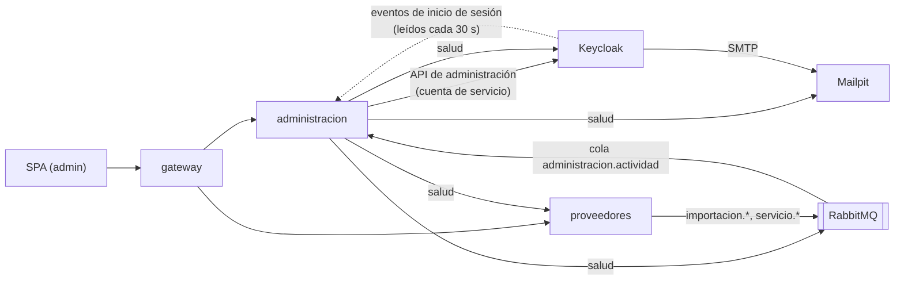

# Gestión de administración: especificación de diseño

| Campo | Valor |
|---|---|
| PRD padre | `docs/superpowers/specs/2026-09-28-plataforma-negociacion-proveedores-design.md` |
| Antecede a | Plan B del sub-proyecto 1 (`docs/superpowers/specs/2026-10-01-experiencia-e-inteligencia-design.md`, sección 8) |
| Fecha | 2026-10-08 |
| Estado | Aprobado por el residente; implementado en los planes "Usuarios y acceso" y "Operación del sistema" |
| Base de código | "Claridad y acceso" terminado (rama `feat/claridad-y-acceso`, commit `2f7a3f2`) |

---

## 0. Contexto y decisiones

El residente mostró como referencia una plataforma completa (menú por áreas, gestión del sistema, agente IA con historial) y pidió que el administrador tenga "una buena gestión, como la que debería tener un administrador". Hoy el administrador solo tiene Importación y una pantalla de Configuración que se llena en el Plan B. El PRD ya le asigna usuarios, catálogos y una bitácora de auditoría, pero nada de eso existe todavía.

| # | Decisión |
|---|---|
| G1 | Orden de trabajo: **este sub-proyecto (Administración) → Plan B → agente IA con historial**. El agente IA va con el sub-proyecto 2, que construye el servicio `ia`. |
| G2 | Funciones incluidas: usuarios y roles, actividad y auditoría, catálogo de servicios, estado del sistema, correos del sistema, centro de ayuda y panel de administración. |
| G3 | Un usuario nuevo obtiene su contraseña de **dos formas, a elección del administrador**: invitación por correo, donde el usuario define su contraseña, o contraseña temporal mostrada una sola vez. |
| G4 | La lógica vive en un **servicio nuevo `administracion`** (FastAPI) con base de datos propia. Keycloak queda detrás de un adaptador. |
| G5 | Usuarios y servicios del catálogo **se desactivan, no se borran**. La bitácora conserva todo lo que pasó. |
| G6 | En desarrollo, los correos llegan a un buzón local (**Mailpit**), como prevé el PRD ("buzón local de desarrollo"). |
| G7 | Los pesos, umbrales y parámetros de puntuación se quedan en el **Plan B**, junto con el servicio de inteligencia que los usa. |

---

## 1. Objetivo y criterios de éxito

**Objetivo:** un administrador gestiona la plataforma sin entrar a Keycloak ni a la base de datos. Da de alta y de baja usuarios, ve quién hizo qué, mantiene el catálogo, sabe si el sistema está sano y encuentra ayuda dentro de la app.

| Criterio | Meta |
|---|---|
| Alta de usuario | Por invitación o con contraseña temporal, en menos de 1 minuto y sin salir de la plataforma |
| Trazabilidad | Toda alta, edición, cambio de rol, desactivación, restablecimiento, cierre de sesiones, inicio de sesión (exitoso o fallido), importación y cambio de catálogo queda en la bitácora con quién, cuándo y resultado |
| Bitácora inmutable | El usuario de base de datos del servicio no puede hacer UPDATE ni DELETE sobre la bitácora (probado automáticamente) |
| Protección | Nadie puede desactivarse ni quitarse el rol de administrador a sí mismo; siempre queda al menos un administrador activo |
| Secretos | Ninguna contraseña aparece en la bitácora, en los logs ni en la base del servicio |
| Calidad | 0 violaciones de axe por página en ambos temas; usable a 375, 768, 1024 y 1440 px sin scroll horizontal; cobertura ≥ 80 % en las reglas de `administracion` |

---

## 2. Alcance

**Incluye:**
- Servicio `administracion` (API, base de datos, adaptador de identidad, lectura de eventos, estado del sistema).
- Cambios en `proveedores`: catálogo editable y eventos de importación y catálogo con quién lo hizo.
- Infraestructura: Mailpit, base de datos y cliente de Keycloak para el servicio, tema de correos en español, ruta en el gateway y scripts para entornos ya creados.
- Pantallas: Panel de administración, Usuarios, Detalle de usuario, Actividad, Catálogo de servicios, Estado del sistema, Correos del sistema y Centro de ayuda.
- Menú con dos áreas nuevas: **Sistema** (solo admin) y **Soporte** (todos).
- Documentación: PRD, arquitectura, README y revisión en navegador en `docs/qa/`.

**No incluye:**
- Pesos, umbrales y parámetros de puntuación; la pantalla Configuración se llena en el Plan B.
- Agente IA con historial (sub-proyecto 2).
- Varias empresas (multi-tenant) y correo real de producción: fuera del alcance v1 del PRD.
- Borrado definitivo de usuarios o servicios (G5).

---

## 3. Arquitectura

### 3.1 Mapa

### 3.2 Servicio `administracion`

- FastAPI con la estructura de `proveedores` y `libs/comun` (`requiere_rol`, `/salud`, logs JSON, errores, mensajes de RabbitMQ).
- Detrás del gateway en `/api/administracion/`. **Todos sus endpoints exigen el rol `admin`.**
- Usa la audiencia `plataforma-api` que ya emite el cliente `web`; no hacen falta mapeadores nuevos.

### 3.3 Datos (`administracion_db`)

| Tabla | Contenido | Permisos del usuario de la aplicación |
|---|---|---|
| `actividad` | id, fecha (`timestamptz`), actor_id, actor_nombre, tipo, objeto_tipo, objeto_id, objeto_nombre, detalle (JSON sin secretos), resultado (`exito` / `fallo`), ip, origen (`keycloak` / `proveedores` / `administracion`), clave_origen (única) | **Solo SELECT e INSERT** |
| `correo_enviado` | id, fecha, tipo (`invitacion` / `restablecimiento`), destinatario, usuario_id, solicitado_por, estado (`enviado` / `fallido`), error | SELECT, INSERT |
| `cursor_eventos` | hasta qué fecha se leyeron los eventos de Keycloak | SELECT, INSERT, UPDATE |

- **Dos usuarios de base de datos:** `administracion_dueno` es dueño del esquema y corre las migraciones; `administracion` es el de la aplicación, con los permisos de la tabla. Así la regla de solo inserción no depende del código.
- `clave_origen` hace idempotente toda inserción: id de evento de Keycloak, id de mensaje de RabbitMQ o un UUID propio.
- Los eventos de `proveedores` son idempotentes por `clave_origen` (`proveedores:{event_id}`), así que no hace falta una tabla de eventos procesados.

### 3.4 Adaptador de identidad

Interfaz `ProveedorIdentidad` con estas operaciones: listar usuarios (búsqueda, rol, estado, paginación), obtener, crear, actualizar datos, fijar roles, activar o desactivar, enviar correo de acción (definir contraseña), fijar contraseña temporal, cerrar sesiones y leer eventos de inicio de sesión desde una fecha.

- **`IdentidadKeycloak`** usa la API de administración de Keycloak con `httpx` y *client credentials* del cliente confidencial `administracion`.
  - La cuenta de servicio tiene solo `view-users`, `manage-users` y `view-events` de `realm-management`. No es superadministrador.
  - Los roles se leen **por usuario** (`/users/{id}/role-mappings/realm`), con hasta 20 consultas a la vez: los endpoints `/roles/*` piden `view-realm`, que la cuenta de servicio no tiene. Razonable hasta unos 1,000 usuarios.
  - Tiempo límite de 5 s por llamada.
- **`IdentidadFalsa`** vive en memoria y se usa en las pruebas.
- Migrar a Entra ID = escribir otra implementación.

### 3.5 Keycloak

- **Cliente `administracion`:** confidencial, solo cuenta de servicio, con el secreto tomado de `infra/.env` (`KEYCLOAK_ADMINISTRACION_SECRET`). En el realm JSON va como marcador `${KEYCLOAK_ADMINISTRACION_SECRET}`; Keycloak lo reemplaza al importar.
- **Eventos:** se activan `LOGIN`, `LOGIN_ERROR` y `LOGOUT` con expiración de 30 días. `administracion` los copia a su bitácora, que no caduca.
- **SMTP:** servidor `mailpit:1025`, remitente "PluriOne" `no-responder@pluri.one.test`.
- **Tema de correos `plataforma`:** textos en español de usted para "defina su contraseña" (invitación y restablecimiento), con la marca. Mensajes con escapes `\uXXXX`, como el tema de login.
- **Vigencia del enlace:** 72 h para invitación y 24 h para restablecimiento.
- **Realm ya importado:** un script idempotente `infra/keycloak/configurar-administracion.sh` (kcadm dentro del contenedor, contraseña por `KC_CLI_PASSWORD`) aplica cliente, eventos, SMTP y tema, como `quitar-otp.sh`.

### 3.6 Cambios en `proveedores`

- **Catálogo editable** (solo `admin`):
  - `POST /servicios`: alta con código, nombre, categoría, unidad y moneda.
  - `PATCH /servicios/{codigo}`: nombre, unidad, activo. Categoría y moneda **solo** si el servicio aún no tiene contratos, porque los precios históricos dependen de ellas.
  - `GET /servicios` sigue devolviendo solo activos; con `incluir_inactivos=true` (admin) devuelve todos.
  - Migración: columna `activo` (por defecto `true`).
  - El código no cambia después de crearse: las importaciones lo usan como llave.
- **Eventos con quién lo hizo** (por el outbox existente):
  - `servicio.actualizado` (el mismo que el Plan B ya espera) con `cambio`: `creado`, `actualizado`, `desactivado` o `activado`, y `actor` {id, nombre}.
  - `importacion.completada` (entidad, filas insertadas y actualizadas, actor) y `importacion.rechazada` (entidad, número de errores, actor).
  - Importaciones por línea de comandos: actor "Sistema (línea de comandos)".

### 3.7 Infraestructura

- **Docker Compose:** servicios `administracion` y `mailpit` (imagen `axllent/mailpit`; SMTP solo en la red interna; interfaz web solo en `127.0.0.1:8025`).
- **PostgreSQL:** `infra/postgres/administracion.sh` crea `administracion_db` y sus dos usuarios. Es idempotente y sirve en los dos casos: corre solo al crear un volumen nuevo (montado como `20-administracion.sh`) y se ejecuta a mano en un volumen existente.
- **Gateway:** ruta `/api/administracion/`. La CSP no cambia.
- **Versión desplegada:** variable `VERSION_APP` (commit corto), por defecto `desarrollo`.

---

## 4. API de `administracion`

| Método y ruta | Uso |
|---|---|
| `GET /usuarios?busqueda&rol&estado&pagina&tamano` | Lista con roles, estado y último acceso (de la bitácora) |
| `POST /usuarios` | Alta: nombre, apellidos, correo, usuario, roles, `metodo` (`invitacion` / `temporal`). Responde el usuario y, solo con `temporal`, la contraseña |
| `GET /usuarios/{id}` | Detalle con último acceso |
| `PATCH /usuarios/{id}` | Nombre, apellidos, correo, roles |
| `POST /usuarios/{id}/desactivar` · `/activar` | Cambia el estado |
| `POST /usuarios/{id}/contrasena` | `metodo` `correo` o `temporal`; con `temporal` responde la contraseña una sola vez |
| `POST /usuarios/{id}/cerrar-sesiones` | Cierra todas sus sesiones |
| `GET /actividad?persona&tipo&desde&hasta&pagina` | Bitácora filtrada, más reciente primero |
| `GET /actividad/exportar?…` | Mismos filtros en CSV (UTF-8 con BOM para Excel), máximo 10,000 filas |
| `GET /correos?pagina` | Correos enviados |
| `GET /estado` | Salud por servicio |
| `GET /resumen` | Datos del panel |

- Errores con el formato existente de `libs/comun`, con código y mensaje en español: `409 usuario_duplicado` / `correo_duplicado`, `409 regla_proteccion`, `503 identidad_no_disponible`.
- El tipo de correo es `invitacion` si el usuario nunca ha iniciado sesión y `restablecimiento` si ya lo hizo.

---

## 5. Bitácora: acciones y textos

La pantalla muestra cada tipo en lenguaje llano:

| Tipo | Texto |
|---|---|
| `sesion.iniciada` | Inició sesión |
| `sesion.fallida` | Intento fallido de inicio de sesión: contraseña incorrecta, cuenta desactivada o cuenta bloqueada temporalmente, según el error de Keycloak |
| `sesion.cerrada` | Cerró sesión |
| `usuario.creado` | Dio de alta a {nombre} |
| `usuario.actualizado` | Editó los datos de {nombre} |
| `usuario.roles_cambiados` | Cambió los roles de {nombre}: {antes} → {después} |
| `usuario.desactivado` · `usuario.activado` | Desactivó / Activó a {nombre} |
| `usuario.correo_contrasena` | Envió a {nombre} un correo para definir su contraseña |
| `usuario.contrasena_temporal` | Asignó una contraseña temporal a {nombre} |
| `usuario.sesiones_cerradas` | Cerró las sesiones de {nombre} |
| `importacion.completada` | Importó {n} {entidad} |
| `importacion.rechazada` | Intentó importar {entidad}; el archivo tenía {n} errores |
| `servicio.creado` · `.actualizado` · `.desactivado` · `.activado` | Dio de alta / Editó / Desactivó / Activó el servicio {código} |

- Los tipos `servicio.*` se derivan del campo `cambio` del evento `servicio.actualizado`.
- Filtro "tipo" por grupos: Sesiones, Usuarios, Importaciones, Catálogo.
- Los textos viven en un solo módulo del front (`web/src/actividad.ts`), con prueba de que todo tipo tiene texto.

---

## 6. Pantallas

Todas usan los componentes existentes (encabezado, tarjetas de indicador, secciones, estados vacíos, "Siguiente paso", términos con ayuda). Van de usted y conservan los filtros en la URL.

**Menú:**
- Área **Sistema** (solo admin): Panel, Usuarios, Actividad, Catálogo, Estado del sistema, Correos, Importación y Configuración (estas dos se mueven desde "Datos", que desaparece).
- Área **Soporte** (todos): Centro de ayuda.
- Cada opción conserva su línea de propósito.

| Pantalla | Ruta | Contenido |
|---|---|---|
| Panel de administración | `/sistema` | Tarjetas: usuarios activos; intentos fallidos en 24 h (advertencia si hay ≥ 1, riesgo si hay ≥ 5); servicios con problemas; correos en 7 días. Debajo: actividad reciente (10), estado compacto y últimas importaciones, con enlaces |
| Usuarios | `/sistema/usuarios` | Tabla: iniciales y nombre con correo, usuario, roles (etiquetas), estado (texto, no solo color), último acceso relativo. Búsqueda, filtros por rol y estado, paginación. Botón "Nuevo usuario" |
| Alta de usuario | panel lateral | Nombre, apellidos, correo, usuario (sugerido del correo), roles con una línea de qué puede hacer cada uno. Pregunta "¿Cómo obtendrá su contraseña?": invitación por correo (recomendada) o contraseña temporal |
| Detalle de usuario | `/sistema/usuarios/:id` | Datos y roles editables; acciones "Enviar correo para definir contraseña", "Asignar contraseña temporal", "Cerrar sesiones", "Desactivar/Activar" (las dos últimas con confirmación que explica la consecuencia); actividad reciente (20) |
| Actividad | `/sistema/actividad` | Tabla: fecha, persona, acción, resultado, IP. Filtros: persona, tipo, desde, hasta. Botón "Exportar CSV" |
| Catálogo de servicios | `/sistema/catalogo` | Tabla: código, nombre, categoría, unidad, moneda, estado. Filtros: categoría y estado. Alta y edición en panel lateral; código de solo lectura al editar; categoría y moneda bloqueadas con explicación si hay contratos |
| Estado del sistema | `/sistema/estado` | Una tarjeta por servicio con estado (icono + texto), tiempo de respuesta y detalle; "Volver a comprobar" y actualización cada 30 s; versión desplegada; últimas importaciones |
| Correos del sistema | `/sistema/correos` | Tabla: fecha, tipo, destinatario, quién lo pidió, estado. En desarrollo, enlace "Abrir buzón de desarrollo" |
| Centro de ayuda | `/ayuda` y `/ayuda/:articulo` | Búsqueda; artículos por tema (Primeros pasos, Proveedores y precios, Datos e importación y, solo para admin, Administración); preguntas frecuentes; glosario completo. Botón "?" en la barra superior. La guía del Tablero enlaza aquí. Contenido en `web/src/ayuda.ts` |

**Contraseña temporal:** se muestra en un diálogo una sola vez, con botón "Copiar" y la advertencia "No se volverá a mostrar. Entréguela a la persona por un medio seguro; deberá cambiarla al entrar." No queda en el estado de la app ni en la URL al cerrar el diálogo.

**Estado de cada servicio:**
- Sano: responde en menos de 1 s.
- Con problemas: tarda 1 s o más, o hay más de 100 mensajes en cola.
- Caído: no responde en 2 s o devuelve error.

Las comprobaciones corren en paralelo:
- base de datos propia;
- `proveedores` (`/salud/listo`);
- Keycloak (documento de descubrimiento del realm);
- RabbitMQ (API de administración, con mensajes listos por cola);
- Mailpit.

---

## 7. Seguridad

- Solo se pueden asignar `admin`, `comprador` y `aprobador`.
- **Reglas de protección**, en el servicio y con prueba:
  - nadie se desactiva a sí mismo;
  - nadie se quita su propio rol `admin`;
  - no se desactiva ni se quita el rol al último administrador activo.
- **Contraseña temporal:**
  - la genera el servidor con `secrets`: 16 caracteres con mayúscula, minúscula, dígito y símbolo, compatible con la política de Keycloak;
  - Keycloak la marca como temporal, así que pide cambiarla al entrar;
  - nunca se guarda, ni se registra en logs ni en la bitácora.
- **Datos de entrada:**
  - correo, nombre y usuario se validan con Pydantic;
  - usuario de 3 a 30 caracteres en minúsculas, dígitos, punto o guion.
- El secreto del cliente `administracion` solo vive en `infra/.env` (no versionado) y en el contenedor.
- La interfaz de Mailpit solo escucha en `127.0.0.1`.
- La regla de solo inserción la garantiza la base de datos (3.3), no solo el código.

---

## 8. Errores y límites conocidos

| Situación | Lo que ve la persona / lo que pasa |
|---|---|
| Keycloak caído o lento (> 5 s) | Usuarios muestra "No se pudo conectar con el servicio de identidad. Intente de nuevo en unos minutos." con "Reintentar"; el resto de la app sigue |
| La invitación no sale (SMTP o Mailpit caído) | El usuario queda creado. Mensaje: "Se creó la cuenta, pero no se pudo enviar la invitación". Ofrece reintentar o asignar contraseña temporal. El correo queda como `fallido` |
| Usuario o correo duplicado | Error junto al campo |
| Regla de protección | Mensaje en llano ("No puede desactivar su propia cuenta", "Debe quedar al menos un administrador activo"); no se aplica nada |
| Falla el registro en la bitácora | La acción ya se aplicó. Mensaje: "La acción se aplicó, pero no quedó en la bitácora"; log de error con el detalle. *Límite:* el registro perdido queda solo en los logs; una cola de reintentos lo resolvería si hiciera falta |
| Keycloak o RabbitMQ no responden al leer eventos | Se reintenta sin avanzar el cursor; las inserciones son idempotentes |
| `administracion` apagado más de 30 días | *Límite documentado:* Keycloak ya borró esos eventos y queda un hueco en la bitácora |
| Exportación de más de 10,000 filas | Se exportan las 10,000 más recientes y la pantalla avisa que acote las fechas |

---

## 9. Pruebas y calidad

- **`administracion`** (pytest, con base de datos real de pruebas como `proveedores`):
  - reglas de protección;
  - contraseña temporal conforme a la política;
  - traducción de eventos de Keycloak y RabbitMQ a registros de bitácora;
  - API con `IdentidadFalsa`;
  - consumo idempotente;
  - estado con servicios simulados;
  - CSV;
  - **prueba de que UPDATE y DELETE sobre `actividad` fallan con el usuario de la aplicación.**
  - Cobertura ≥ 80 % en las reglas.
- **`IdentidadKeycloak`:** pruebas con respuestas HTTP simuladas de la API de Keycloak (crear, roles por usuario, correo de acción, contraseña temporal, eventos).
- **`proveedores`:** alta, edición y desactivación del catálogo; bloqueo de categoría y moneda con contratos; migración; eventos con actor.
- **Prueba de humo** (`infra/smoke_test.py`) contra el stack real:
  - alta de un usuario de prueba por invitación;
  - el correo aparece en Mailpit;
  - desactivarlo;
  - la bitácora tiene ambas acciones.
- **Web** (Vitest + Testing Library + axe en cada pantalla):
  - la contraseña temporal se muestra una vez y desaparece al cerrar;
  - errores junto al campo;
  - reglas de protección;
  - filtros en la URL;
  - enlace de exportación;
  - menú Sistema solo para admin;
  - el Centro de ayuda oculta Administración a otros roles;
  - todo tipo de bitácora tiene texto.
- **Revisión en navegador** como en "Claridad y acceso": 4 anchos × 2 temas, axe con contraste, documento en `docs/qa/`.
- Salida de pruebas limpia, Prettier y lint sin errores.

---

## 10. Entrega

Dos planes, cada uno con revisión por tarea, revisión final y fusión a `main`:

1. **"Usuarios y acceso":**
   - servicio `administracion` base;
   - base de datos con los dos usuarios;
   - cliente de Keycloak, eventos, SMTP y tema de correos;
   - Mailpit;
   - scripts para entornos existentes;
   - API de usuarios y correos;
   - bitácora de acciones de usuarios e inicios de sesión;
   - pantallas Usuarios, Detalle y Correos;
   - área Sistema del menú;
   - prueba de humo.
2. **"Operación del sistema":**
   - eventos y catálogo editable en `proveedores`;
   - consumo de eventos en `administracion`;
   - Actividad completa con filtros y CSV;
   - Estado del sistema, Panel y Centro de ayuda (con área Soporte);
   - revisión en navegador;
   - documentación.

Ejecución con subagentes, como el plan anterior.

---

## 11. Documentación a actualizar

- **PRD:**
  - tabla de servicios (agregar `administracion`);
  - mapa de servicios;
  - matriz de permisos (gestionar usuarios, ver actividad y estado: Admin);
  - entidades por servicio.
- **README:**
  - servicios y puertos (Mailpit en `localhost:8025`);
  - variables nuevas de `.env`;
  - scripts para entornos existentes;
  - sección "Interfaz".
- **`docs/qa/`:** revisión en navegador del sub-proyecto.
