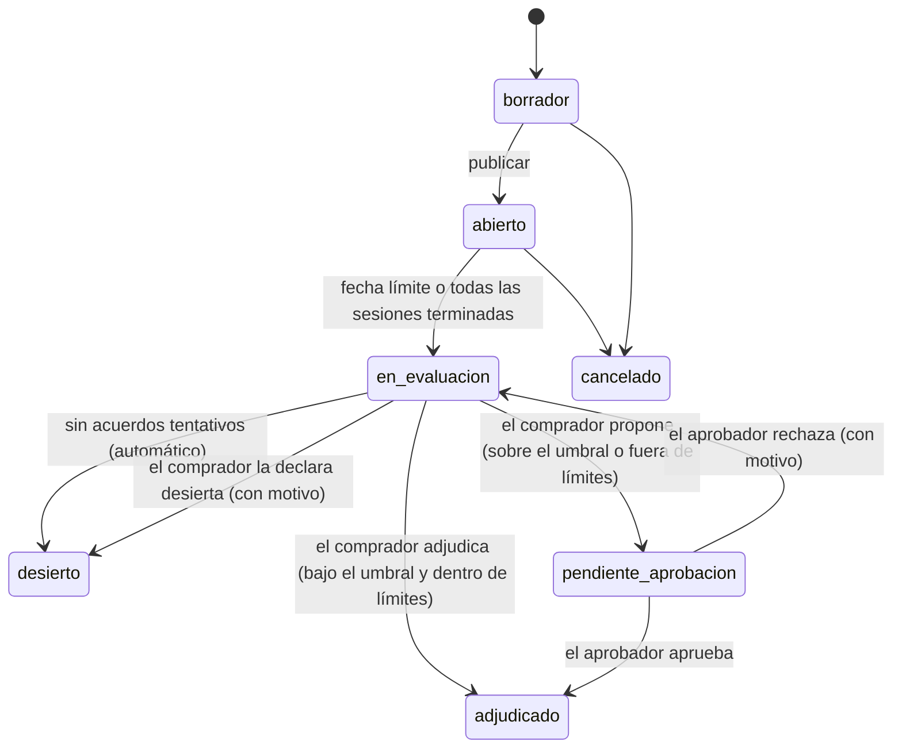

# 4′ — Adjudicación y aprobación: especificación de diseño

| Campo | Valor |
|---|---|
| PRD padre | `docs/superpowers/specs/2026-09-28-plataforma-negociacion-proveedores-design.md` (§3.1, §3.5, §4.5, §5.1, §6.6.1) |
| Fecha | 2026-10-16 |
| Estado | Borrador. El residente pidió diseñarla tal como la describe el PRD; las decisiones que el PRD no toma están marcadas como **decisión del diseño** |
| Base de código | `main` en `a872ed5` (N1 completa, entregables 2 y 3) |
| Rama | `feat/adjudicacion` |
| Ventana | 21/10 – 11/11/2026 (PRD §6.6.1, opción A del residente) |

---

## 0. Contexto y decisiones

Con N1, una negociación termina en «En evaluación» con varios acuerdos tentativos. Ninguno es
vinculante. Este incremento cierra el flujo del PRD:

1. `inteligencia` recomienda uno de los acuerdos.
2. El comprador propone la adjudicación.
3. Si el monto o los límites lo exigen, un aprobador la aprueba.
4. Se avisa a los proveedores, y el contrato nuevo entra al historial, donde mejora el precio de
   referencia de la siguiente negociación.

| # | Decisión | Origen |
|---|---|---|
| D1 | La **recomendación** es una suma ponderada de cuatro criterios (costo total, desempeño, riesgo y SLA), normalizados entre los candidatos con min-max. Pesos por defecto: 40, 30, 15 y 15. Los configura el administrador y el comprador los puede ajustar por evento. | PRD §4.5 |
| D2 | La **explicación** se arma con plantillas, sin LLM: el aporte de cada criterio, el margen entre el primero y el segundo, y el análisis de sensibilidad. | PRD §4.5 y §6.6.1 |
| D3 | La recomendación vive en `inteligencia` (`POST /adjudicacion/recomendacion`), que ya tiene la puntuación, los contratos, el tipo de cambio y las reglas de unidades. `negociacion` la llama por HTTP con el token del usuario, como la referencia de precios. | PRD §2.2 |
| D4 | Si el comprador **se aparta** de la recomendación, debe justificarlo, y la justificación queda en la bitácora. | PRD §3.5 |
| D5 | **Quién aprueba:** el aprobador, si el costo total en MXN supera el umbral; si no, el propio comprador. En ese caso su propuesta es la adjudicación y no hay un paso aparte. Quien propone nunca aprueba su propia propuesta, aunque tenga los dos roles. | PRD §3.1 y §5.1 |
| D6 | Un acuerdo marcado **fuera de límites** (N1: aceptado o propuesto a mano con confirmación) siempre pasa por el aprobador, sin importar el monto. N1 se lo prometió al comprador («lo verá el aprobador»). | Decisión del diseño, por N1 |
| D7 | **Umbral de aprobación por defecto: $500,000 MXN** de costo total. Lo configura el administrador junto a los pesos. | Decisión del diseño (el PRD no da cifra) |
| D8 | **Desierta:** una negociación que llega a «En evaluación» sin acuerdos tentativos pasa sola a «Desierta». El comprador también puede declararla desierta desde «En evaluación», con motivo, si ningún acuerdo le conviene. | PRD §3.1; lo segundo es decisión del diseño, para que un evento no quede atorado |
| D9 | **Aviso a los proveedores por correo y, si su enlace sigue vigente, también en el portal.** El enlace vence en la fecha límite (PRD §5.1), y casi siempre la adjudicación llega después. El correo no nombra al ganador ni revela montos. | Desviación del PRD (§3.5 dice «en el portal»), explicada |
| D10 | Al aprobarse, `negociacion` publica `negociacion.adjudicada` con los términos del contrato. `proveedores` lo consume, registra el contrato y publica el `contrato.registrado` de siempre, que `inteligencia` ya consume. | PRD §2.2; que `inteligencia` lo reciba por `contrato.registrado` y no directamente es decisión del diseño, para no duplicar |
| D11 | **Validación:** 200 eventos simulados. El «mejor verdadero» se calcula con la calidad latente del generador en lugar del desempeño observado, con los mismos pesos. Meta: acierto top-1 ≥ 85 %, reportado. | PRD §4.5 |
| D12 | **Entrega en dos planes** (§12): 4′a, los servicios, y 4′b, la interfaz. Mismo esquema que N1. | Decisión del diseño |

**Fuera de 4′:**
- Adjudicar por línea a varios proveedores: se adjudica el evento completo a un proveedor.
- Redactar la explicación con LLM (N2).
- El estado de las negociaciones y el ahorro logrado en el Tablero (capacidad 10, aparte).
- Las propuestas de negociación (6) y el simulador de escenarios (8).

---

## 1. Objetivo y criterios de éxito

**Objetivo:** cuando una negociación termina, el comprador ve los acuerdos ordenados y explicados,
propone uno, y la adjudicación aprobada produce un contrato real en el historial.

| Criterio | Meta |
|---|---|
| Acierto top-1 de la recomendación contra el mejor verdadero (200 eventos simulados) | ≥ 85 %, reportado en `docs/qa/validacion-inteligencia.md` |
| Adjudicaciones sin aprobación cuando superan el umbral o salen de límites | **0** (pruebas de la API) |
| Aprobaciones hechas por quien propuso | **0** (pruebas de la API) |
| Contrato registrado en `proveedores` por cada adjudicación aprobada | Sí, verificado en la prueba de humo |
| Cobertura de `inteligencia/dominio/adjudicacion.py` | ≥ 80 % |
| Accesibilidad | 0 violaciones de axe (con contraste) en cada vista nueva, a 375, 768, 1024 y 1440 px, en claro y oscuro |

Si el acierto queda bajo la meta, se reporta y se analiza por qué. Los criterios no se ajustan
para forzar el número.

---

## 2. Ciclo de vida

Estados nuevos del evento: `pendiente_aprobacion`, `adjudicado` y `desierto` (PRD §3.1).

**Reglas del ciclo:**
- Cada transición se hace con el evento bloqueado (`FOR UPDATE`) y solo desde su estado de origen.
  Otra petición que llegue tarde recibe un 409 que explica el estado actual.
- **Cierre de N1:** `cerrar_eventos_terminados` (`turnos.py`) y la tarea de fecha límite
  (`vencimientos.py`) llevan el evento a `desierto` en lugar de `en_evaluacion` si no tiene
  ninguna sesión en `acuerdo_tentativo`. Publican `negociacion.desierta` y envían los avisos (§5.5).
- **Después de un rechazo,** el comprador puede volver a proponer el mismo acuerdo u otro, o
  declarar la negociación desierta.
- **Sesiones:** sus estados no cambian. La ganadora se identifica por la adjudicación (§5.1).

---

## 3. Recomendación (`inteligencia`)

### 3.1 Candidatos y criterios

Un **candidato** es una sesión en `acuerdo_tentativo`. Sus valores son los de la última oferta del
proveedor en esa sesión: los precios por línea y las palancas acordadas. Así lo define N1.

| Criterio | Valor por candidato | Mejor si |
|---|---|---|
| **Costo total** | Σ por línea de `precio × cantidad × plazo` (en las unidades mensuales: `usuario_mes`, `vcpu_mes`, `gb_mes` y `mes`) o `precio × cantidad` (en las de consumo, como horas o tickets, cuya cantidad ya es del contrato), más la cuota de implementación acordada. El plazo es el acordado en la palanca `plazo_meses` o, si no se negoció, el del evento. Va en la moneda del evento y también en MXN, al tipo de cambio más reciente. | menor |
| **Desempeño** | La puntuación actual del proveedor, de 0 a 100 (PRD §4.4). Sin puntuación: la media de las puntuaciones de los proveedores de su categoría principal; si esa categoría no tiene ninguna, la de todos; si nadie tiene, 50 (**decisión del diseño**). | mayor |
| **Riesgo** | De 0 a 1, el promedio de tres componentes (la combinación es **decisión del diseño**; los factores son del PRD): **concentración**, la fracción del gasto anual vigente en MXN que tendría el proveedor si se le adjudica: su gasto actual más el costo anual del candidato, entre el gasto total más ese costo anual. El gasto anual es el mismo «gasto anual contratado» del Tablero. El costo anual del candidato es su costo total sin la cuota, entre el plazo y por 12; **tendencia de incidentes**, el aumento relativo de incidentes críticos de los últimos 3 meses frente a los 3 anteriores, de 0 a 1 (`max(0, (últimos − anteriores) / max(anteriores, 1))` acotado a 1); y **sin historial**, 1 si tiene menos de 6 meses de desempeño y 0 si no. | menor |
| **SLA** | La disponibilidad acordada en la palanca `sla_disponibilidad`. Si no se negoció: en una renovación, la del contrato vigente; en una compra, ninguna. | mayor |

### 3.2 Puntaje

- **Normalización min-max entre los candidatos.** Para «mayor es mejor», `(x − min) / (max − min)`;
  para «menor es mejor», `(max − x) / (max − min)`.
  - Si todos valen lo mismo en un criterio, ese criterio vale 1 para todos y no decide nada.
  - Un SLA ausente vale 0 cuando otros candidatos sí tienen SLA; si ninguno lo tiene, el criterio
    vale 1 para todos (**decisión del diseño**).
- **Puntaje** = Σ `peso × normalizado`, con los pesos sumando 100. Va de 0 a 100 y se muestra con un
  decimal.
- **Orden:** por puntaje, de mayor a menor. Los empates se resuelven por menor costo total, luego
  mayor desempeño y luego nombre del proveedor, para que el resultado sea determinista.
- **Un solo candidato:** se recomienda, con el texto «Es el único acuerdo tentativo».

### 3.3 Explicación (plantillas en `inteligencia/textos.py` o equivalente)

1. **Resumen:** «Recomendamos a {A}: obtiene {pA} de 100 contra {pB} de {B}, un margen de {m}.»
2. **Aporte de cada criterio** al puntaje del recomendado, con su dato: costo total en MXN,
   puntuación, riesgo como «bajo/medio/alto» con sus componentes y SLA en %.
3. **Sensibilidad:** para cada criterio, el peso más cercano al actual con el que ganaría otro
   candidato.
   - El peso de ese criterio se mueve de 1 en 1 entre 0 y 100, y los demás se reescalan en
     proporción para seguir sumando 100.
   - El texto dice: «Si el peso del costo pasara de 40 a 22, ganaría {C}», o «Ningún peso del
     costo cambia al ganador».

### 3.4 Configuración

- **Columnas nuevas en `configuracion`** (una migración de Alembic):
  - `peso_costo`, `peso_desempeno`, `peso_riesgo` y `peso_sla`, enteros de 0 a 100 que suman
    100, con 40, 30, 15 y 15 por defecto;
  - `umbral_aprobacion`, en MXN, de $500,000 por defecto.
- `GET/PUT /configuracion` las incluye. El cambio publica la `configuracion.actualizada` de
  siempre, así que queda en la Actividad.

### 3.5 API

`POST /adjudicacion/recomendacion` (roles internos):

- **Cuerpo:**
  - `moneda`;
  - `pesos` opcionales (si faltan, se usan los configurados);
  - `candidatos`, cada uno con: `id` (el de la sesión), `proveedor_id`, `plazo_meses`,
    `cuota_implementacion`, `sla` (opcional) y `lineas` (`codigo_servicio`, `unidad`, `cantidad`
    y `precio`).
- **Respuesta:**
  - los `pesos` y el `umbral_aprobacion` usados, y el `tipo_cambio` (periodo y valor);
  - por candidato: costo total en su moneda y en MXN, desempeño, riesgo (valor y componentes),
    SLA, normalizados, aportes, puntaje y lugar;
  - el `recomendado`, el `margen`, la `explicacion` (lista de textos) y la `sensibilidad`.
- **Errores:** pesos que no suman 100, o candidatos vacíos o repetidos, dan 422. Un proveedor que
  `inteligencia` no conoce cuenta como sin historial y sin puntuación. Un evento en USD sin tipo de
  cambio registrado da 409 `tipo_cambio_no_disponible`: nunca se calcula un costo de $0 MXN.

### 3.6 Validación (`inteligencia/validacion.py`)

- Se agrega la sección «Adjudicación» al reporte que ya genera
  `uv run python -m inteligencia.validacion --verdad datos/verdad_oculta.json`.
- **200 eventos simulados con semilla fija.** Cada uno es una categoría con 2 a 5 proveedores
  activos de esa categoría.
  - El precio acordado de cada uno se deriva de su `nivel_precio` latente sobre el P50 del servicio.
  - El SLA y el plazo son iguales para todos o se varían con la semilla.
  - Las formas exactas las decide el constructor.
- **Recomendado:** se calcula con los datos observados.
- **Mejor verdadero:** se calcula igual, pero con `calidad × 100` (latente) en lugar de la
  puntuación. El costo, el riesgo y el SLA son los mismos en los dos cálculos.
- **Se reporta:** el acierto top-1, el acierto top-2 y el margen promedio de los fallos. Meta:
  ≥ 85 %.

---

## 4. Adjudicación (`negociacion`)

### 4.1 Datos

**Tabla nueva `adjudicacion`.** Guarda una fila por propuesta, así que los rechazos quedan como
historial:

| Grupo | Columnas |
|---|---|
| Identidad | `id`, `evento_id` (FK), `sesion_id` (FK, la elegida) |
| Propuesta | `propuesta_por_id`, `propuesta_por_nombre`, `propuesta_en` |
| Recomendación | `recomendada_sesion_id`; `se_aparta` (bool); `justificacion` (texto, obligatoria si `se_aparta`) |
| Monto y regla | `costo_total` (moneda del evento); `costo_total_mxn`; `requiere_aprobacion` (bool); `motivo_aprobacion` (`umbral` o `fuera_de_limites`, o ambos, o ninguno) |
| Foto | `recomendacion` (JSONB): la respuesta completa de `inteligencia`, con los pesos usados |
| Decisión | `estado` (`pendiente`, `aprobada`, `rechazada` o `directa`); `decidida_por_id`, `decidida_por_nombre` y `decidida_en`; `motivo_rechazo` |
| Contrato | `contrato_folio`, al adjudicarse |

**Otros cambios en los datos:**
- El evento gana `motivo_desierta`.
- `ESTADOS_EVENTO` suma los tres estados nuevos.
- La migración amplía los `CHECK`.
- El usuario de la aplicación puede actualizar `adjudicacion` solo en las columnas de la decisión.
  Basta con `GRANT UPDATE (columnas)`, al estilo de la ADR-006.

### 4.2 API (prefijo `/negociacion`)

| Método y ruta | Rol | Qué hace |
|---|---|---|
| `GET /eventos/{id}/evaluacion?pesos=40,30,15,15` | interno | Arma los candidatos, pide la recomendación a `inteligencia` y devuelve también la adjudicación vigente o pendiente y el historial de propuestas. Sin `pesos`, usa los configurados. Solo funciona en `en_evaluacion`, `pendiente_aprobacion`, `adjudicado` y `desierto` |
| `POST /eventos/{id}/adjudicacion` | comprador | Cuerpo: `sesion_id`, `pesos` (el texto «40,30,15,15», como en la consulta) y `justificacion`. Vuelve a pedir la recomendación en el servidor (nunca confía en la del cliente) y aplica D4 a D7. Responde con el evento actualizado |
| `POST /eventos/{id}/adjudicacion/aprobar` | aprobador | Cuerpo: `adjudicacion_id`, el `vigente.id` de la evaluación que el aprobador revisó. Solo en `pendiente_aprobacion` y si no es quien propuso (si lo es: 403 con `codigo` `misma_persona`). Si `adjudicacion_id` no es la propuesta pendiente: 409 `propuesta_distinta`. El evento pasa a `adjudicado` |
| `POST /eventos/{id}/adjudicacion/rechazar` | aprobador | Cuerpo: `adjudicacion_id` y `motivo` (de 1 a 500 caracteres). Misma regla de persona y el mismo 409 `propuesta_distinta`. El evento vuelve a `en_evaluacion` |
| `POST /eventos/{id}/desierta` | comprador | Cuerpo: `motivo`. Solo desde `en_evaluacion` |

**Comportamiento común:**
- Errores RFC 9457 en español con `codigo` estable. Por ejemplo:
  - `justificacion_requerida`;
  - `estado_invalido`, que dice el estado actual;
  - `misma_persona`;
  - `propuesta_distinta`;
  - `sesion_no_candidata`.
- `inteligencia` caída: 503, igual que en N1.
- Cada acción deja su fila en la `bitacora`: `adjudicacion.propuesta`, `adjudicacion.aprobada`,
  `adjudicacion.directa`, `adjudicacion.rechazada` y `evento.desierto`, con su detalle.

### 4.3 Monto y regla de aprobación

- `requiere_aprobacion` es verdadero si `costo_total_mxn > umbral_aprobacion` o si la sesión
  elegida tiene `fuera_de_limites`.
- **Si no la requiere,** la propuesta queda `directa`, el evento pasa a `adjudicado` en la misma
  transacción y la decide el comprador.
- **Si la requiere,** queda `pendiente` y el evento pasa a `pendiente_aprobacion`.

### 4.4 Términos del contrato (al adjudicarse)

| Campo | Valor |
|---|---|
| `folio` | `C-` seguido del folio del evento, por ejemplo `C-NEG-2026-0004` (cumple el patrón `^[A-Z0-9-]{3,30}$`) |
| `tipo` | `nuevo` en una compra; `renovacion` en una renovación |
| `fecha_inicio` | Compra: el día siguiente a la adjudicación, en hora de la Ciudad de México. Renovación: el día siguiente al fin del contrato vigente (`foto.contrato.fecha_fin`). **Decisión del diseño** |
| `fecha_fin` | `fecha_inicio` más el plazo en meses, menos un día |
| `plazo_pago_dias` | El acordado. Si no se negoció: el del contrato vigente en una renovación, y 30 en una compra (**decisión del diseño**) |
| `sla_disponibilidad`, `tope_aumento_pct` | El acordado. Si no se negoció: el del contrato vigente en una renovación, y nulo en una compra |
| `cuota_implementacion` | La acordada; si no se negoció, 0 |
| `moneda` | La del evento |
| `lineas` | `codigo_servicio`, `cantidad` y `precio_unitario` (el acordado) |

### 4.5 Eventos nuevos

Se declaran en `topologia.py`, `definitions.json`, `docs/arquitectura/eventos.md` y `asyncapi.yaml`:

| Evento | Payload | Lo reciben |
|---|---|---|
| `negociacion.adjudicada` | `folio`, `titulo`, `tipo`, `proveedor_id`, `proveedor` (nombre), `costo_total_mxn`, `contrato` (los términos de §4.4), `aprobacion` (`directa` o `aprobada`), `actor` | `proveedores` (cola nueva `proveedores.eventos`) y `administracion` |
| `negociacion.desierta` | `folio`, `titulo`, `motivo` (o `sin_acuerdos`), `actor` | `administracion` |
| `negociacion.resultado_enviado` | Como `negociacion.invitacion_enviada`, más `resultado` (`adjudicada`, `no_elegida` o `desierta`) | `administracion` |

### 4.6 Aviso a los proveedores (D9)

- **Cuándo y a quién:** al adjudicarse o declararse desierta, se envía un correo a cada sesión
  del evento que tenga destinatario. El envío usa `correo.py`, es asíncrono y no bloquea la
  transacción.
- **Contenido:** el folio, el título y el resultado para ese proveedor:
  - «Su oferta fue adjudicada; el equipo de compras se pondrá en contacto»;
  - «La negociación se adjudicó a otra propuesta»;
  - «La negociación se declaró desierta».
- **Lo que nunca dice:** el nombre del ganador ni ningún monto.
- **Registro:** cada envío publica `negociacion.resultado_enviado`, igual que una invitación.
- **En el portal:** `VistaPortal` gana el campo `resultado` (`adjudicada`, `no_elegida`, `desierta`
  o nulo), y el portal muestra el aviso mientras el enlace siga vigente.

### 4.7 Desierta automática

Al cerrar un evento sin acuerdos (§2):
- `motivo_desierta` queda vacío y el payload dice `sin_acuerdos`;
- la bitácora registra `evento.desierto` con `actor_tipo` `sistema`;
- se envían los avisos.

---

## 5. Contrato nuevo (`proveedores`)

- **Consumidor nuevo** con `ConsumidorEventos` de `libs/comun`:
  - cola `proveedores.eventos` ← `negociacion.adjudicada`, con su cola de fallidos;
  - tabla `evento_procesado` y su migración.
- **Al recibir `negociacion.adjudicada`:**
  - crea el contrato y sus líneas en una transacción. Resuelve el servicio por código y el
    proveedor por id;
  - si el folio ya existe, no hace nada (idempotencia por `folio`);
  - publica `contrato.registrado` con el mismo payload que la importación.
- Un proveedor o servicio desconocido es un error del evento: se reintenta y, tras 5 intentos, va a
  la cola de fallidos, que el Estado del sistema ya avisa.
- `inteligencia` lo recibe como cualquier contrato y lo suma al historial y al precio de
  referencia. Así se cierra el ciclo del PRD §2.2.

---

## 6. Actividad y Correos (`administracion`)

- **`traducir()` reconoce los tres eventos nuevos:**
  - «Adjudicó la negociación {folio} «{título}» a {proveedor} ({aprobación})»;
  - «Declaró desierta la negociación…»;
  - el resultado enviado, igual que una invitación y con su `CorreoEnviado`, de `tipo`
    `resultado_negociacion`.
- Los textos del servidor y de la web coinciden (`actividad.ts`), como exige la prueba existente.
- Correos muestra el tipo nuevo como «Resultado de negociación».

---

## 7. Interfaz

### 7.1 Página de la negociación (`/negociaciones/:id`)

**En evaluación (comprador):** sección «Evaluación» antes de las sesiones.
- **Tabla de candidatos:** proveedor, costo total (con su equivalente en MXN si el evento es en
  USD), desempeño, riesgo (bajo/medio/alto, con sus componentes en el detalle), SLA, puntaje y
  lugar. Al recomendado lo marca una etiqueta con texto, nunca solo con color.
- **Explicación y sensibilidad**, en texto.
- **«Ajustar pesos»:** cuatro campos que suman 100, con el total en vivo, y «Recalcular». Usa el
  patrón del editor de N1.
- **«Adjudicar» en cada fila.** Abre una confirmación que:
  - dice si se adjudicará directamente o irá al aprobador, y por qué (el umbral o fuera de
    límites);
  - pide la justificación si no es el recomendado.
- **«Declarar desierta»**, con motivo.

**Pendiente de aprobación:**
- El comprador ve la propuesta y «Esperando aprobación de un aprobador».
- El aprobador ve la misma evaluación, con la propuesta resaltada, la justificación, las marcas de
  fuera de límites y el motivo de la regla. Tiene «Aprobar» y «Rechazar» (este con motivo).
- Quien propuso, si también es aprobador, no ve los botones: ve el texto «Usted propuso esta
  adjudicación; la aprueba otra persona».

**Adjudicada o desierta:** un resumen con quién propuso, quién aprobó, cuándo, el proveedor, el
costo total, el folio del contrato y el historial de propuestas rechazadas, si las hubo.

### 7.2 Otras pantallas

- **Negociaciones:**
  - filtros «Por aprobar», «Adjudicada» y «Desierta», y etiquetas de estado nuevas;
  - el aprobador entra con «Por aprobar» si hay alguna (**decisión del diseño**).
- **Portal:** en un estado final, el aviso del resultado (§4.6).
- **Configuración (administrador):**
  - sección «Adjudicación» con los cuatro pesos (total en vivo) y el umbral en MXN;
  - mismas reglas de validación que los pesos de la puntuación.
- **Ayuda y glosario:**
  - un artículo «Adjudicar y aprobar»;
  - términos nuevos: adjudicación, umbral de aprobación y desierta;
  - el texto de «Cómo usar PluriOne» deja de decir que la aprobación llegará después.
- **Accesibilidad:** las reglas de N1 siguen:
  - las regiones vivas siempre están montadas;
  - el foco pasa a `#contenido` cuando desaparece el botón usado;
  - `Termino` acompaña al primer término técnico;
  - 0 violaciones de axe.

---

## 8. Errores y casos límite

| Caso | Comportamiento |
|---|---|
| Dos compradores proponen a la vez | El segundo recibe 409 `estado_invalido`, porque el evento ya no está en evaluación |
| El aprobador aprueba algo que ya se rechazó | 409 `estado_invalido` |
| El aprobador aprueba o rechaza una propuesta que no es la pendiente (por ejemplo, la de una evaluación que ya cambió) | 409 `propuesta_distinta`; no se decide nada |
| La sesión elegida no es candidata (no está en `acuerdo_tentativo` o es de otro evento) | 422 `sesion_no_candidata` |
| No es el recomendado y la justificación viene vacía | 422 `justificacion_requerida` |
| `inteligencia` no responde al proponer | 503; no se guarda nada |
| Evento en USD sin tipo de cambio registrado | `inteligencia` responde 409 `tipo_cambio_no_disponible` y `negociacion` responde 503; no se guarda nada (nunca se calcula un costo de $0 MXN, que dejaría sin efecto el umbral) |
| El correo de resultado falla | La adjudicación no se revierte: el envío queda `fallido` en Correos, como una invitación |
| `proveedores` no puede crear el contrato | El evento va a la cola de fallidos y el Estado del sistema lo avisa; la adjudicación sigue válida |
| Evento en USD | El ranking no cambia (todos comparten moneda); el umbral se compara en MXN |

---

## 9. Pruebas

**`inteligencia`:**
- Unitarias del dominio: normalización, empates, un solo candidato, SLA ausente, sensibilidad y
  costo por tipo de unidad.
- Propiedades con Hypothesis:
  - el puntaje queda entre 0 y 100;
  - el recomendado tiene el puntaje máximo;
  - subir el peso de un criterio nunca baja el puntaje del candidato mejor en ese criterio.
- API: 422 y respuesta completa.

**`negociacion`:** API con base real (Testcontainers):
- la regla de aprobación en sus cuatro combinaciones;
- `misma_persona`;
- un rechazo y una segunda propuesta;
- la desierta automática y la manual;
- el outbox de los tres eventos;
- la bitácora;
- los avisos (con un enviador de prueba);
- que el correo y el portal no filtren al ganador ni los montos.

**Otros servicios y simulación:**
- `proveedores`: el consumidor crea el contrato, es idempotente y publica `contrato.registrado`.
- `administracion`: la traducción de los tres eventos y los textos iguales a los de la web.
- Simulación: el reporte de §3.6.
- Prueba de humo: llega de una negociación a un contrato registrado en `proveedores`.

**Web:** pruebas de cada vista y rol, de la regla de foco y de axe en jsdom, y la revisión en
navegador como en N1b.

---

## 10. Documentación

- **README:** «Qué está hecho y qué falta» (capacidades 7 y 9) y las métricas.
- **Arquitectura:** `docs/arquitectura/` (eventos, AsyncAPI, modelo de datos y contratos
  regenerados con `infra/exportar_contratos.py`), y la ADR-011 «Quién aprueba una adjudicación»
  (D5 a D7).
- **PRD:** la nota de la §3.5 sobre D9.
- **QA:** la sección de adjudicación en `docs/qa/validacion-inteligencia.md`.

---

## 11. Lo que queda al constructor

- La forma exacta de los eventos simulados de §3.6, siempre que use la semilla y la calidad
  latente como dice D11.
- Los textos finales de las plantillas, con las reglas de texto del proyecto (español, «usted» y
  sin jerga).
- La distribución de módulos en `inteligencia/dominio/` y en `negociacion/`, siguiendo los
  patrones existentes.

---

## 12. Entrega

- **4′a · Adjudicación en los servicios:**
  - `inteligencia` (dominio, API, configuración y validación);
  - `negociacion` (estados, tabla, API, eventos, avisos y desierta);
  - `proveedores` (consumidor y contrato);
  - `administracion` (Actividad y Correos), con sus textos en la web;
  - topología, prueba de humo y documentos de arquitectura.
- **4′b · Adjudicación en la interfaz:**
  - evaluación, propuesta, aprobación y resumen;
  - filtros de Negociaciones;
  - portal;
  - Configuración;
  - ayuda y glosario;
  - revisión en navegador.
